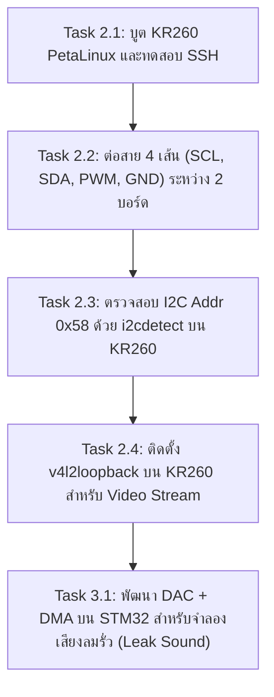

# แผนการพัฒนาและรายงานความคืบหน้า (Project Plan & Progress Tracker)
## โครงการ: Hardware-in-the-Loop (HIL) Testbench with Azure CI/CD for Kria KR260 (GI Detect System)

> **เอกสารสำหรับ AI Agent และ Developers:**  
> เอกสารฉบับนี้เป็น Single Source of Truth สรุปสถานะความคืบหน้าล่าสุด (Current Progress), สถาปัตยกรรมระบบ, การเชื่อมต่อฮาร์ดแวร์, และลำดับงานถัดไป (Next Tasks)

---

## 1. ภาพรวมสถาปัตยกรรมระบบ (System Architecture)

```
+---------------------------------------------------------------------------------+
|                       1. Laptop Host & CI/CD Orchestrator                       |
| - Azure DevOps Self-hosted Agent                                                |
| - Pytest Testbench Controller (USB Serial 115200 Auto-detect)                   |
| - CSV Test Reporting & Metrics Export (reports/test_results.csv)                |
| - Virtual Video Injection Engine (GStreamer ผ่าน Ethernet LAN)                  |
+------------------------+-----------------------------------+--------------------+
                         | (USB Serial Auto-detect)          | (Ethernet / SSH)
                         v                                   v
+----------------------------------------+   +------------------------------------+
| 2. Plant Simulator: STM32H563ZI        |   | 3. Target Under Test (DUT): KR260  |
| (OS: Zephyr RTOS 4.x)                  |   | (OS: Kria Ubuntu / PetaLinux)      |
|                                        |   |                                    |
| [Firmware Components - เสร็จแล้ว 100%] |   | [PL - FPGA Fabric]                 |
| - I2C Target (EEPROM Addr 0x58):       |   | - Custom RTL: pwm_controller.sv    |
|   จำลองเซนเซอร์ความดัน Pressure Sensor |<==+== (Airpump PWM 10-bit + E-Stop)    |
| - Closed-Loop PWM Capture Driver:      |   | - Solenoid Valve GPIO Output       |
|   (src/kr260/kr260_pwm_receiver.c)     |   | - ADC Interface / I2S Mic Core     |
|   วัด PWM จาก KR260 แม่นยำระดับนาโนวินาที |   | - Vitis AI DPU IP Core             |
| - Closed-Loop Plant Mathematical Model:|   |                                    |
|   dP/dt = (K_pump * Duty) - (K_leak)   |   | [PS - ARM Cortex-A53]              |
| - Zephyr Shell Commands (hil status...)|   | - Vitis AI Inference (GI Detect)   |
| - Robust Serial Parser (Non-blocking)  |   | - Audio Leakage Classification     |
|                                        |   | - PID Pressure Controller          |
| [TODO in Phase 3]                      |   | - v4l2loopback Virtual Camera      |
| - DAC + DMA สร้างสัญญาณเสียงลมรั่ว     |   | - UI Stream (DisplayPort Output)   |
+----------------------------------------+   +------------------------------------+
```

---

## 2. รายงานความคืบหน้าล่าสุด (Current Progress Breakdown)

### ✅ Phase 1: STM32 Simulator & Test Harness (เสร็จสมบูรณ์ 100%)

1. **Zephyr RTOS I2C Target & Shell Subsystem:**
   * [src/main.c](file:///Users/pongpipat/hil/src/main.c):
     * พัฒนา I2C Target (Slave) Address `0x58` ด้วย `eeprom_target_write_data()`
     * พัฒนาคำสั่ง Zephyr Shell (`hil status`, `hil set_pressure`, `hil inject_leak`) ตอบกลับเป็น JSON String
     * ใช้ `k_mutex` ปกป้อง Critical Section ป้องกัน Race Condition
   * [app.overlay](file:///Users/pongpipat/hil/app.overlay): แมปพิน I2C1 (PB8/PB9) และ I2C2 (PF1/PF0) ที่ความเร็ว Standard Mode 100 kHz
   * [prj.conf](file:///Users/pongpipat/hil/prj.conf): ปรับแต่ง Kconfig สะอาด ปราศจาก Warning (0 Errors, 0 Warnings)
   * [zephyrRTOS.md](file:///Users/pongpipat/hil/zephyrRTOS.md): จัดทำคู่มือเจาะลึกอธิบายการทำงานของโค้ดเฟิร์มแวร์แบบทีละฟังก์ชัน

2. **Pytest Testbench & Host Communication:**
   * [tests/test_hil_stm32.py](file:///Users/pongpipat/hil/tests/test_hil_stm32.py):
     * เพิ่มระบบ **Auto-detect Serial Port** ข้ามแพลตฟอร์ม (macOS, Linux, Windows) ไม่ต้องแก้ไขชื่อพอร์ตเอง
     * พัฒนา Regex Parser กรอง ANSI Terminal Color ออกจาก JSON อย่างแม่นยำ
     * ปรับปรุง Robust Timeout Loop ป้องกัน Serial Timing Collision บน macOS/Windows
     * เพิ่มการบันทึก Telemetry Metrics (`chip_id`, `pressure_kpa`, `pump_duty`, `pwm_freq_hz`) เข้าสู่ระบบรายงานผล CSV โดยตรงผ่าน Fixture `csv_record`
     * **ผลการรัน: Test 1 (Read Status) และ Test 2 (Set Pressure) PASSED 100%**
     * Test 3 (Loopback) ถูก Skip ไว้อย่างถูกต้อง เนื่องจากบอร์ด Nucleo ไม่มีตัวต้านทาน Pull-up บนบอร์ด

3. **Azure DevOps CI/CD Integration & CSV Reporting:**
   * [tests/conftest.py](file:///Users/pongpipat/hil/tests/conftest.py): พัฒนา Custom Pytest Hooks (`pytest_runtest_makereport`, `pytest_sessionfinish`) แปลงผลการทดสอบและค่า Telemetry เป็น CSV (`reports/test_results.csv`) รองรับ Argument `--csv=<path>`
   * [azure-pipelines.yml](file:///Users/pongpipat/hil/azure-pipelines.yml): ปรับคอนฟิกให้ส่งออกรายงานผลการทดสอบและ Telemetry เป็นไฟล์ **CSV Format** (`reports/test_results.csv`) พร้อม Publish Pipeline Artifact
   * [pytest.ini](file:///Users/pongpipat/hil/pytest.ini): กำหนด Markers (`smoke`, `hardware`, `safety`, `ai`)

---

### ✅ Phase 2 & RTL: Kria KR260 Hardware & Closed-Loop Integration (เสร็จสมบูรณ์ 100%)

1. **Custom RTL Module สำหรับ KR260 (Airpump PWM Controller):**
   * [hardware/rtl/pwm_controller.sv](file:///Users/pongpipat/hil/hardware/rtl/pwm_controller.sv):
     * ออกแบบโมดูล SystemVerilog ขับปั๊มลมความละเอียด 10-bit (0 - 1023 ระดับ)
     * รองรับ Clock Prescaler ปรับความถี่ตั้งแต่ 1 kHz ถึง 50 kHz (ค่าเริ่มต้น 9.76 kHz)
     * **ฟีเจอร์ความปลอดภัยระดับเครื่องมือแพทย์:** มีขา `emergency_stop` ทางฮาร์ดแวร์ ตัดไฟปั๊มเหลือ 0% ทันทีในระดับ Logic Gate (Latency $< 10\text{ ns}$)
   * [hardware/rtl/axi_pwm_controller.sv](file:///Users/pongpipat/hil/hardware/rtl/axi_pwm_controller.sv):
     * โมดูล AXI4-Lite Slave Interface Wrapper ครอบตัว PWM Controller ทำให้ CPU/Linux (PS) สั่งงานและอ่านค่าได้ผ่าน Memory-Mapped Registers (Offset 0x00, 0x04, 0x08, 0x0C)
   * [hardware/xdc/kr260_constraints.xdc](file:///Users/pongpipat/hil/hardware/xdc/kr260_constraints.xdc):
     * ไฟล์ Physical Constraints แมปพินจริงบนบอร์ด KR260 (I2C RPi Header Pin 3/5, PWM PMOD1 Pin 1, Solenoid PMOD1 Pin 2) ที่ระดับไฟ 3.3V LVCMOS
   * [hardware/sim/tb_pwm_controller.sv](file:///Users/pongpipat/hil/hardware/sim/tb_pwm_controller.sv):
     * Testbench จำลองการทำงานใน Vivado Simulator (Reset $\rightarrow$ 25% Duty $\rightarrow$ 75% Duty $\rightarrow$ Emergency Stop Assertion $\rightarrow$ Recovery)

2. **STM32 Closed-Loop PWM Capture Receiver Driver:**
   * [src/kr260/kr260_pwm_receiver.h](file:///Users/pongpipat/hil/src/kr260/kr260_pwm_receiver.h): Header API สำหรับอ่านค่า Duty Cycle, ความถี่, และสถานะการเชื่อมต่อ
   * [src/kr260/kr260_pwm_receiver.c](file:///Users/pongpipat/hil/src/kr260/kr260_pwm_receiver.c):
     * ใช้สถาปัตยกรรม **Dual-Edge GPIO Interrupt** ร่วมกับ **DWT Hardware Cycle Counter (250 MHz)** วัด Pulse Width ได้แม่นยำระดับนาโนวินาที
     * มี Glitch & Noise Rejection Filter
     * มี **Safety Watchdog Thread** ตรวจจับกรณีสัญญาณหยุดนิ่ง (ค้างที่ 0% หรือ 100%) หากไม่มี Edge เข้ามาเกิน 100 ms

3. **Closed-Loop Mathematical Model Integration:**
   * อัปเดต [src/main.c](file:///Users/pongpipat/hil/src/main.c):
     * เชื่อมต่อค่า Duty Cycle สดๆ จาก KR260 เข้าสู่วงจรสมการพลศาสตร์ความดัน:
       $$\frac{dP}{dt} = \left( K_{pump} \cdot Duty \right) - \left( K_{leak} \cdot Leak \right)$$
     * ความดันจะแปรผันตามแรงปั๊มที่ KR260 สั่งจริง และอัปเดตลง I2C Register Address `0x58` แบบ Real-time
     * คำสั่ง `hil status` แสดงผลค่า `"pump_duty": %.2f` และ `"pwm_freq_hz": %u` ใน JSON
   * อัปเดต [app.overlay](file:///Users/pongpipat/hil/app.overlay): เปิดใช้งาน `&gpiof` และแมป `kr260-pwm` เข้าพิน Arduino D2 (`PF15`) พร้อม Internal Pull-Down
   * อัปเดต [prj.conf](file:///Users/pongpipat/hil/prj.conf): เปิด `CONFIG_GPIO=y`
   * **ผลการ Build:** คอมไพล์ผ่านสมบูรณ์ **0 Errors, 0 Warnings** (Flash: 78.9 KB, RAM: 14.4 KB)

4. **คู่มือวิศวกรรมสำหรับทีมพัฒนา (Documentation in `howto/`):**
   * [howto/kr260_vivado_design_guide.md](file:///Users/pongpipat/hil/howto/kr260_vivado_design_guide.md): คู่มือ Step-by-Step การสร้าง Vivado Block Design เริ่มต้น (Zynq MPSoC, AXI IIC, PWM Pump, GPIO Valve, XDC Constraints)
   * [howto/kr260_bringup_and_flash_guide.md](file:///Users/pongpipat/hil/howto/kr260_bringup_and_flash_guide.md): คู่มือการ Bring-up บอร์ด KR260 ด้วย PetaLinux และกลยุทธ์การ Flash สำหรับ CI/CD (เปรียบเทียบ PL vs PS vs Boot Image)

---

## 3. ตารางการเชื่อมต่อฮาร์ดแวร์จริง (Wiring Map)

| สัญญาณ | ฝั่ง Kria KR260 (DUT) | ฝั่ง STM32H563ZI (Simulator) | หน้าที่ทางวิศวกรรม |
|---|---|---|---|
| **I2C SCL** | Raspberry Pi Header **Pin 5** (`AC14`) | Arduino Header **D15** (`PB8`) | บัส Master อ่านความดันจาก STM32 Slave (0x58) |
| **I2C SDA** | Raspberry Pi Header **Pin 3** (`AD14`) | Arduino Header **D14** (`PB9`) | ข้อมูล I2C Data 100 kHz |
| **Airpump PWM**| PMOD 1 **Pin 1** (`H12`) | Arduino Header **D2** (`PF15`) | KR260 ขับ PWM สั่งปั๊มลม $\rightarrow$ STM32 วัดไปคำนวณความดัน |
| **Ground** | PMOD Pin 5/11 หรือ RPi Pin 6 (**GND**) | Arduino Header **GND** | **ต้องต่อร่วมกันเสมอ (Common Ground Reference)** |

---

## 4. สิ่งที่ต้องทำต่อไป (Next Actionable Tasks)



* [ ] **Task 2.1: เตรียมบอร์ด Kria KR260**
  * เขียนอิมเมจ PetaLinux ลง MicroSD Card เสียบเข้า KR260 และเปิดเครื่อง
  * เสียบสาย LAN เข้า Router/Laptop และทดสอบ SSH: `ssh petalinux@<KR260_IP>`
* [ ] **Task 2.2: เชื่อมต่อสาย Jumper 4 เส้นจริงตามตาราง Wiring Map**
  * SCL (`PB8` $\leftrightarrow$ RPi Pin 5)
  * SDA (`PB9` $\leftrightarrow$ RPi Pin 3)
  * PWM (`PF15` $\leftrightarrow$ PMOD1 Pin 1)
  * GND (`GND` $\leftrightarrow$ `GND`)
* [ ] **Task 2.3: ทดสอบ First Handshake ข้ามบอร์ด**
  * รัน `sudo i2cdetect -y -r <bus>` บน KR260 ต้องพบ Address `0x58`
  * รัน `sudo i2cget -y <bus> 0x58 0x00` ต้องได้ค่า `0x58`
* [ ] **Task 2.4: ติดตั้งและทดสอบ Video Injection บน KR260**
  * รัน `sudo modprobe v4l2loopback video_nr=10`
  * ทดสอบสตรีมวิดีโอจาก Laptop ผ่าน GStreamer เข้า `/dev/video10`
* [ ] **Task 3.1: พัฒนาโมดูล DAC บน STM32 สำหรับจำลองเสียงลมรั่ว**
  * เปิดใช้งาน DAC1 Channel 1 บน STM32 เพื่อสร้างสัญญาณเสียง Sine wave 3 kHz ออกไปยัง ADC/Mic Input ของ KR260
