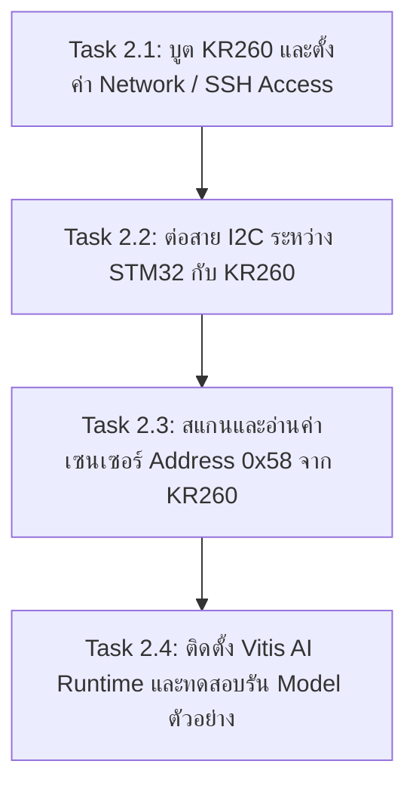

# แผนการพัฒนาและรายงานความคืบหน้า (Project Plan & Progress Tracker)
## โครงการ: Hardware-in-the-Loop (HIL) Testbench with Azure CI/CD for Kria KR260 (GI Detect System)

> **เอกสารสำหรับ AI Agent และ Developers:**  
> เอกสารฉบับนี้เป็น Single Source of Truth สรุปสถานะความคืบหน้าล่าสุด (Current Progress), การปรับเปลี่ยนสถาปัตยกรรม (Architectural Refinements), และลำดับงานถัดไป (Next Tasks)

---

## 1. ภาพรวมสถาปัตยกรรมระบบ (Updated System Architecture)

```
+---------------------------------------------------------------------------------+
|                       1. Laptop Host & CI/CD Orchestrator                       |
| - Azure DevOps Self-hosted Agent                                                |
| - Pytest Testbench Controller (USB Serial 115200 Auto-detect)                   |
| - Pure JUnit XML Test Reporting (PublishTestResults@2)                          |
| - Virtual Video Injection Engine (GStreamer ผ่าน Ethernet LAN)                  |
+------------------------+-----------------------------------+--------------------+
                         | (USB Serial Auto-detect)          | (Ethernet / SSH)
                         v                                   v
+----------------------------------------+   +------------------------------------+
| 2. Plant Simulator: STM32H563ZI        |   | 3. Target Under Test (DUT): KR260  |
| (OS: Zephyr RTOS 4.x)                  |   | (OS: Kria Ubuntu / PetaLinux)      |
|                                        |   |                                    |
| [Firmware Components - เสร็จแล้ว 100%] |   | [PL - FPGA Fabric]                 |
| - I2C Target (EEPROM Addr 0x58):       |   | - ADC Interface / I2S Mic Core     |
|   จำลองเซนเซอร์ความดัน Pressure Sensor |<==+== PWM Airpump Output               |
| - Background Physics Simulation Thread:|   | - Solenoid Valve GPIO Output       |
|   คำนวณความดัน Real-time 20 Hz (Mutex) |<==+== Vitis AI DPU IP Core             |
| - Zephyr Shell Commands (hil status...)|   |                                    |
| - Robust Serial Parser (Non-blocking)  |   | [PS - ARM Cortex-A53]              |
|                                        |   | - Vitis AI Inference (GI Detect)   |
| [TODO in Phase 3 & 4]                  |   | - Audio Leakage Classification     |
| - Timer Input Capture วัด PWM ปั๊มลม    |   | - PID Pressure Controller          |
| - DAC + DMA สร้างสัญญาณเสียงลมรั่ว     |   | - v4l2loopback Virtual Camera      |
+----------------------------------------+   | - UI Stream (DisplayPort Output)   |
                                             +------------------------------------+
```

---

## 2. สถานะความคืบหน้าล่าสุด (Current Progress Snapshot)

### ✅ Phase 1: STM32 Plant Simulator & Test Harness (เสร็จสมบูรณ์ 100%)

1. **Zephyr RTOS Firmware บน STM32H563ZI:**
   * [src/main.c](file:///Users/pongpipat/hil/src/main.c):
     * พัฒนา I2C Target (Slave) Address `0x58` ด้วย `eeprom_target_write_data()`
     * พัฒนา Background RTOS Thread คำนวณพลศาสตร์ความดันแบบ Real-time ทุก 50ms (20 Hz)
     * ใช้ `k_mutex` ปกป้อง Critical Section ป้องกัน Race Condition
     * พัฒนาคำสั่ง Zephyr Shell (`hil status`, `hil set_pressure`, `hil inject_leak`) ตอบกลับเป็น JSON String
   * [app.overlay](file:///Users/pongpipat/hil/app.overlay): แมปพิน I2C1 (PB8/PB9) และ I2C2 (PF1/PF0) ที่ความเร็ว Standard Mode 100 kHz
   * [prj.conf](file:///Users/pongpipat/hil/prj.conf): ปรับแต่ง Kconfig สะอาด ปราศจาก Warning (0 Errors, 0 Warnings)
   * [zephyrRTOS.md](file:///Users/pongpipat/hil/zephyrRTOS.md): จัดทำคู่มือเจาะลึกอธิบายการทำงานของโค้ดแบบทีละฟังก์ชัน
   * [howto/kr260_vivado_design_guide.md](file:///Users/pongpipat/hil/howto/kr260_vivado_design_guide.md): คู่มือ Step-by-Step การสร้าง Vivado Block Design เริ่มต้น (Zynq MPSoC, AXI IIC, PWM Pump, GPIO Valve, XDC Constraints)
   * [howto/kr260_bringup_and_flash_guide.md](file:///Users/pongpipat/hil/howto/kr260_bringup_and_flash_guide.md): คู่มือการ Bring-up บอร์ด KR260 ด้วย Vivado + PetaLinux และกลยุทธ์การ Flash สำหรับ CI/CD (PL vs PS vs Boot Image)
2. **Kria KR260 Custom RTL Modules (Hardware Development เริ่มต้น):**
   * [hardware/rtl/pwm_controller.sv](file:///Users/pongpipat/hil/hardware/rtl/pwm_controller.sv): Custom Airpump PWM Controller 10-bit พร้อมระบบ Hardware Emergency Interlock
   * [hardware/sim/tb_pwm_controller.sv](file:///Users/pongpipat/hil/hardware/sim/tb_pwm_controller.sv): Testbench จำลองการทำงานและตรวจสอบ Assertions ใน Vivado Simulator
3. **Pytest Testbench & Host Communication:**
   * [tests/test_hil_stm32.py](file:///Users/pongpipat/hil/tests/test_hil_stm32.py):
     * เพิ่มระบบ **Auto-detect Serial Port** (`/dev/tty.usbmodem*`) ไม่ต้องแก้ไขชื่อพอร์ตเอง
     * พัฒนา Regex Parser กรอง ANSI Terminal Color ออกจาก JSON อย่างแม่นยำ
     * ปรับปรุง Robust Timeout Loop ป้องกัน Serial Timing Collision บน macOS
     * **ผลการรัน: Test 1 (Read Status) และ Test 2 (Set Pressure) PASSED 100%**
     * Test 3 (Loopback) ถูก Skip ไว้อย่างถูกต้อง เนื่องจากบอร์ด Nucleo ไม่มีตัวต้านทาน Pull-up ภายนอก โดยจะนำไปต่อจริงกับ KR260 ใน Phase 2
3. **Azure DevOps CI/CD Integration:**
   * [azure-pipelines.yml](file:///Users/pongpipat/hil/azure-pipelines.yml): ปรับคอนฟิกให้ส่งออกเฉพาะ **JUnit XML** (`reports/test_results.xml`) เข้าสู่ Azure Tests Dashboard โดยตรง
   * [pytest.ini](file:///Users/pongpipat/hil/pytest.ini): กำหนด Markers (`smoke`, `hardware`, `safety`, `ai`)

---

## 3. มีอะไรเปลี่ยนไปจากแผนเดิมบ้าง? (Architectural Refinements)

| หัวข้อ | แผนเดิม | แผนปัจจุบันที่ปรับปรุงแล้ว | เหตุผลทางวิศวกรรม |
|---|---|---|---|
| **การส่งวิดีโอเข้า KR260** | ต่อสาย USB-A จาก Laptop เข้า USB-A ของ KR260 ตรงๆ | ใช้ **`v4l2loopback` + GStreamer ผ่าน Ethernet LAN** | พอร์ต USB บน Laptop และ KR260 เป็น USB Host ทั้งคู่ ต่อตรงกันไม่ได้ การส่งผ่าน LAN มีความเสถียรสูงและทำ Automated ใน CI/CD ได้ทันที |
| **I2C Verification** | พยายามทำ Self-test Loopback บนบอร์ด STM32 ตัวเอง | **ข้าม Loopback บน STM32 แล้วนำไปต่อ I2C ตรงกับ KR260 ใน Phase 2** | บอร์ด Nucleo ไม่มี Onboard Pull-up Resistor ทำให้สัญญาณลอย และหน้าที่จริงของ STM32 คือเป็น Slave ให้ KR260 อ่าน |
| **Test Reporting** | บันทึกทั้ง CSV และ JUnit XML | **เน้น Pure JUnit XML เพียวๆ** | สอดคล้องกับ Azure DevOps ที่มีแท็บ Tests รองรับ XML โดยตรง ทำให้ Pipeline รวดเร็วและคลีนขึ้น |

---

## 4. สิ่งที่ต้องทำต่อไป (Next Actionable Tasks)

### 🚀 เป้าหมายถัดไป: เข้าสู่ Phase 2 (Kria KR260 Standalone Setup & Interface Bring-up)



#### รายละเอียดงานใน Task 2.1 ถึง 2.4:

* [ ] **Task 2.1: เตรียมบอร์ด Kria KR260**
  * แฟลช MicroSD Card ด้วย Kria Ubuntu 22.04 LTS หรือ PetaLinux
  * เชื่อมต่อสาย LAN และตั้งค่า Static IP หรือจด DHCP IP ของบอร์ด
  * ทดสอบเชื่อมต่อ SSH จาก Laptop ไปยัง KR260: `ssh ubuntu@<KR260_IP>`
* [ ] **Task 2.2: เชื่อมต่อสายสัญญาณ I2C ระหว่าง STM32 กับ KR260**
  * ต่อสาย Jumper 3 เส้น:
    1. **SCL:** พิน `PB8` (STM32 Arduino D15) $\longleftrightarrow$ ขา SCL ของพอร์ต I2C บน KR260 (เช่น RPi Header หรือ PMOD)
    2. **SDA:** พิน `PB9` (STM32 Arduino D14) $\longleftrightarrow$ ขา SDA ของพอร์ต I2C บน KR260
    3. **GND:** `GND` ของ STM32 $\longleftrightarrow$ `GND` ของ KR260 *(ห้ามลืมเด็ดขาดเพื่อให้อ้างอิง Ground ร่วมกัน)*
* [ ] **Task 2.3: ทดสอบการสื่อสาร I2C ข้ามบอร์ด (First Inter-board Handshake)**
  * รันคำสั่งบน KR260: `sudo i2cdetect -y -r <i2c_bus_num>`
  * ตรวจสอบว่ามองเห็น Address **`0x58`** บนตารางหรือไม่
  * ใช้คำสั่ง `sudo i2cget -y <i2c_bus_num> 0x58 0x00` เพื่ออ่าน Chip ID (ต้องได้ค่า `0x58`)
* [ ] **Task 2.4: ทดสอบ Vitis AI Runtime บน KR260**
  * ตรวจสอบความพร้อมของ DPU IP Core ด้วยคำสั่ง `xdputil query`
  * รัน Inference โมเดลทดสอบเพื่อตรวจวัด Latency และ FPS เบื้องต้น

---

## 5. คำแนะนำสำหรับ AI ในการเริ่มงานต่อ (Instruction for Next Agent)

เมื่อเริ่ม Turn ถัดไป ให้ดำเนินการดังนี้:
1. **ตรวจสอบความพร้อมของบอร์ด Kria KR260:** สอบถามผู้ใช้ว่ามีบอร์ด KR260 อยู่ข้างตัวและเปิดเครื่องบูตติดแล้วหรือไม่
2. **ชี้เป้า Pinout บน KR260:** แนะนำตำแหน่งขา I2C และ Ground บนบอร์ด KR260 (เช่น ขา Raspberry Pi Header Pin 3 SDA, Pin 5 SCL, Pin 6 GND) เพื่อให้ผู้ใช้ต่อสายเข้ากับ STM32 ได้อย่างถูกต้อง
3. **สร้าง Test Suite ชุดที่ 2:** สร้างไฟล์ `tests/test_02_kr260_interfaces.py` สำหรับทดสอบ SSH และอ่าน I2C จาก KR260 ผ่าน Pytest บน Laptop
