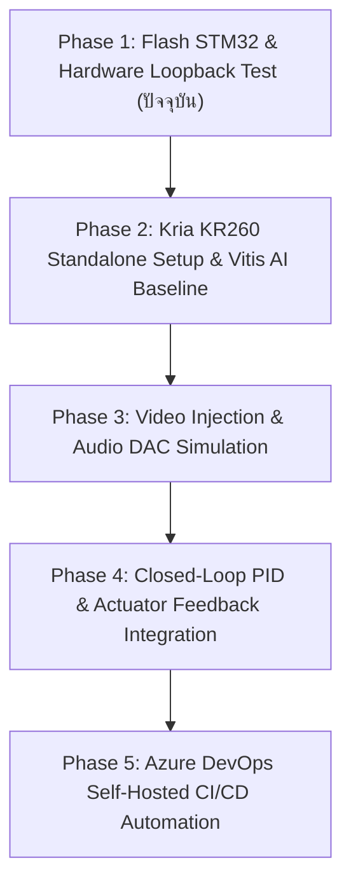

# แผนการพัฒนาและรายงานความคืบหน้า (Project Plan & Progress Tracker)
## โครงการ: Hardware-in-the-Loop (HIL) Testbench with Azure CI/CD for Kria KR260 (GI Detect System)

> **เอกสารสำหรับ AI Agent และ Developers:**  
> โปรดอ่านเอกสารนี้ก่อนเริ่มทำงานต่อ เพื่อทำความเข้าใจสถาปัตยกรรมระบบ สถานะปัจจุบัน (Current Progress) และงานในลำดับถัดไป (Next Milestones)

---

## 1. ภาพรวมสถาปัตยกรรมระบบ (System Architecture)

ระบบแบ่งออกเป็น 3 ส่วนหลักที่ทำงานร่วมกันแบบ Closed-Loop HIL:

```
+---------------------------------------------------------------------------------+
|                       1. Laptop Host & CI/CD Orchestrator                       |
| - Azure DevOps Self-hosted Agent                                                |
| - Pytest Testbench Controller (ส่งคำสั่ง & อ่านค่าตรวจสอบ)                       |
| - Virtual Video Injection Engine (ส่ง Frame ภาพจำลองเข้า KR260)                 |
+------------------------+-----------------------------------+--------------------+
                         | (USB Serial 115200)               | (Ethernet / SSH)
                         v                                   v
+----------------------------------------+   +------------------------------------+
| 2. Plant Simulator: STM32H563ZI        |   | 3. Target Under Test (DUT): KR260  |
| (OS: Zephyr RTOS 4.x)                  |   | (OS: Kria Ubuntu / PetaLinux)      |
|                                        |   |                                    |
| [Firmware Components]                  |   | [PL - FPGA Fabric]                 |
| - I2C Target (EEPROM Addr 0x58):       |   | - ADC Interface / I2S Mic Core     |
|   จำลองเซนเซอร์ความดัน Pressure Sensor |<--+-- PWM Airpump Output               |
| - I2C Master Loopback (PF1/PF0):       |   | - Solenoid Valve GPIO Output       |
|   ใช้ทำ Self-test บนบอร์ดตัวเอง        |<--+-- Vitis AI DPU IP Core             |
| - Background Physics Simulation Thread:|   |                                    |
|   จำลองการเปลี่ยนแปลงความดันแบบ Real-time  |   | [PS - ARM Cortex-A53]              |
| - Zephyr Shell Commands (hil status...)|   | - Vitis AI Inference (GI Detect)   |
| - [TODO] Timer Input Capture วัด PWM   |   | - Audio Leakage Classification     |
| - [TODO] DAC + DMA สร้างสัญญาณเสียง Mic|   | - PID Pressure Controller          |
|                                        |   | - UI Stream (DisplayPort Output)   |
+----------------------------------------+   +------------------------------------+
```

---

## 2. สถานะความคืบหน้าปัจจุบัน (Current Progress)

### ✅ สิ่งที่ทำเสร็จสมบูรณ์แล้ว (Completed Milestones)

1. **โครงสร้างโปรเจกต์ HIL STM32 (Zephyr RTOS Out-of-tree):**
   * [CMakeLists.txt](file:///Users/pongpipat/hil/CMakeLists.txt): ตั้งค่าดึง Zephyr Base จาก `~/stm32/zephyr`
   * [prj.conf](file:///Users/pongpipat/hil/prj.conf): เปิดใช้งาน `CONFIG_I2C_TARGET`, `CONFIG_I2C_EEPROM_TARGET`, `CONFIG_SHELL`
   * [app.overlay](file:///Users/pongpipat/hil/app.overlay): แมปพินฮาร์ดแวร์บน STM32H563ZI:
     * `I2C1`: Target (Slave) Address `0x58` (พิน Arduino D15/D14: `PB8` SCL, `PB9` SDA)
     * `I2C2`: Controller (Master) สำหรับ Loopback (พิน Morpho: `PF1` SCL, `PF0` SDA)
   * [src/main.c](file:///Users/pongpipat/hil/src/main.c):
     * Background RTOS Thread คำนวณความดัน และอัปเดตลง EEPROM Target Memory ผ่าน `eeprom_target_write_data()`
     * ฟังก์ชัน I2C Master-to-Slave Loopback
     * คำสั่ง Zephyr Shell (`hil status`, `hil set_pressure`, `hil inject_leak`, `hil loopback`) ตอบกลับเป็น JSON
2. **การคอมไพล์ (Build Validation):**
   * แก้ไข Warning `-Wdouble-promotion` ด้วย Explicit Double Cast
   * คอมไพล์ผ่านสมบูรณ์ **0 Errors, 0 Warnings** (Binary: `build/zephyr/zephyr.elf`)
3. **ระบบทดสอบฝั่ง Host (Pytest Framework):**
   * [requirements.txt](file:///Users/pongpipat/hil/requirements.txt): กำหนด dependencies (`pytest`, `pyserial`)
   * [tests/test_hil_stm32.py](file:///Users/pongpipat/hil/tests/test_hil_stm32.py): เขียน Automated Test Cases ครอบคลุมการอ่านสถานะ JSON, การเซ็ตค่าความดัน, และการรัน Loopback
4. **การจัดเก็บเวอร์ชัน (Version Control):**
   * ทำการ Initial Commit และ Push ขึ้น GitHub เรียบร้อยแล้ว:
     Repository: [https://github.com/riwrivvriw/kria260-stm32-hil-cicd](https://github.com/riwrivvriw/kria260-stm32-hil-cicd)

---

## 3. แผนการดำเนินงานระยะถัดไป (Detailed Implementation Roadmap)



### Phase 1: Flash STM32 & Physical Loopback Verification (งานปัจจุบัน)
* [ ] นำบอร์ด STM32H563ZI เสียบสาย USB เข้า Laptop และสั่ง `west flash`
* [ ] นำสาย Jumper เชื่อมขา I2C1 เข้ากับ I2C2 บนบอร์ด:
  * `PB8` (I2C1 SCL) <---> `PF1` (I2C2 SCL)
  * `PB9` (I2C1 SDA) <---> `PF0` (I2C2 SDA)
* [ ] รันคำสั่ง `pytest tests/test_hil_stm32.py -v` เพื่อตรวจรับรองว่า STM32 ทำงานถูกต้อง 100%

---

### Phase 2: Kria KR260 Standalone Setup & Vitis AI Baseline
* [ ] ติดตั้ง Kria Ubuntu 22.04 LTS หรือ PetaLinux บน KR260
* [ ] ตั้งค่า Static IP / DHCP และเปิด SSH ให้ Laptop สามารถเข้าถึงได้
* [ ] ทดสอบรัน Vitis AI DPU Runtime ด้วยโมเดลทดสอบพื้นฐาน (ResNet หรือ YOLO)
* [ ] เขียน Script ฝั่ง KR260 สำหรับอ่าน I2C Bus (`i2c-tools` / `i2cget -y <bus> 0x58 0x02 w`)

---

### Phase 3: Video Injection & Audio (Leakage Sound) Simulation
* [ ] **Video Injection Strategy (สำหรับตรวจจับ GI Open/Closed):**
  * ติดตั้ง `v4l2loopback` บน KR260 เพื่อสร้างอุปกรณ์กล้องเสมือน `/dev/video0`
  * Laptop ส่งสตรีมไฟล์วิดีโอ Test Dataset เข้า `/dev/video0` บน KR260 ผ่าน Network Socket / GStreamer
* [ ] **Audio Leakage Simulation (สำหรับตรวจจับเสียงลมรั่ว):**
  * อัปเดตเฟิร์มแวร์ STM32 เปิดใช้งาน **DAC + DMA**
  * บันทึกเสียง Leakage Sound (Sine wave 3kHz หรือเสียงลมรั่วจริง) ไว้ใน Flash ของ STM32
  * ยิงสัญญาณเสียงผ่านขา DAC เข้า ADC/Mic Port ของ KR260 เมื่อได้รับคำสั่ง `hil inject_leak 1`

---

### Phase 4: Closed-Loop PID & Actuator Feedback Integration
* [ ] **Actuator Measurement บน STM32:**
  * ต่อขา Airpump PWM จาก KR260 เข้า Timer Input Capture ของ STM32 เพื่อวัด Duty Cycle (0-100%)
  * ต่อขา Solenoid Valve Control เข้า GPIO Input ของ STM32 เพื่อตรวจจับสถานะ เปิด/ปิด
* [ ] **Closed-Loop Mathematical Model บน STM32:**
  * อัปเดตสมการฟิสิกส์ใน `src/main.c`:
    $$P_{t+\Delta t} = P_t + \left( K_{pump} \cdot Duty - K_{valve} \cdot Valve_{open} - K_{leak} \cdot Leak \right) \cdot \Delta t$$
  * ทำให้ PID Controller บน KR260 ต้องปรับ PWM เพื่อรักษาระดับความดันตามการเปลี่ยนแปลงของ Plant จริง

---

### Phase 5: Azure DevOps Self-Hosted CI/CD Automation
* [ ] ติดตั้ง Azure DevOps Self-Hosted Agent บนเครื่อง Laptop
* [ ] สร้างไฟล์ `.azure-pipelines.yml`:
  1. Trigger เมื่อมี PR หรือ Push เข้า branch `main`
  2. สั่ง build PS Application และ bitstream
  3. ส่งไฟล์ไปยัง KR260 ผ่าน SCP และสั่ง reload FPGA bitstream ด้วย `xmutil loadapp`
  4. รัน `pytest tests/` บน Laptop แบบ Headless
  5. Publish ผลการทดสอบ (JUnit XML) และ Test Artifacts ขึ้น Azure Pipelines

---

## 4. ข้อตกลงการเชื่อมต่อฮาร์ดแวร์ (Hardware Interface Contract)

| สัญญาณ | แหล่งกำเนิด (Source) | ปลายทาง (Destination) | โพรโทคอล / ลักษณะสัญญาณ | หมายเหตุ |
|---|---|---|---|---|
| **Pressure Sensor** | STM32H5 (PB8/PB9) | KR260 PL/PS I2C | I2C Target (Addr `0x58`, 400kHz) | Reg 0x00: Chip ID, Reg 0x02-0x03: Pressure |
| **Leakage Mic** | STM32H5 (DAC Out) | KR260 ADC Input | Analog Signal (0 - 3.3V) | จำลองเสียงความถี่การรั่วไหล |
| **Airpump Control**| KR260 PL Output | STM32H5 Timer Capture | PWM Signal (0 - 100% Duty Cycle) | วัดความเร็วปั๊มเข้าสู่ Plant Model |
| **Solenoid Valve** | KR260 PL Output | STM32H5 GPIO Input | Digital High/Low (3.3V) | วัดสถานะเปิด/ปิดวาล์วระบายลม |
| **Camera Feed** | Laptop Host | KR260 PS | GStreamer / v4l2loopback | สตรีมวิดีโอจำลองสภาพลำไส้ |
| **HIL Commands** | Laptop Host (Pytest)| STM32H5 (ST-Link USB) | UART Shell (115200 8N1) | ส่งคำสั่ง SCPI/JSON-RPC |

---

## 5. คำแนะนำสำหรับ AI ในการเริ่มงานต่อ (Instruction for Next Agent)

เมื่อเริ่ม Turn ใหม่ ให้ปฏิบัติตามแนวทางนี้:
1. **ตรวจสอบความพร้อมของฮาร์ดแวร์:** ถามผู้ใช้ว่าบอร์ด STM32H563ZI แฟลชผ่านแล้วหรือไม่ และเชื่อมต่อสายพิน Loopback แล้วหรือยัง
2. **ขยายผลตาม Phase:** หาก Phase 1 เรียบร้อย ให้เริ่มงาน **Phase 2 (KR260 Environment Setup)** หรือเริ่มเพิ่มฟังก์ชัน **DAC / Timer Input Capture** บน STM32
3. **การรักษาคุณภาพโค้ด:** 
   * โค้ด C บน STM32 ต้องปฏิบัติตามมาตรฐาน Zephyr RTOS Driver Model
   * สื่อสาร อธิบาย และ Comment โค้ดเป็น **ภาษาไทย** เสมอ
   * แสดงวิธีการทำงานของโค้ดให้ผู้ใช้เห็นอย่างชัดเจนตามกฎของระบบ
