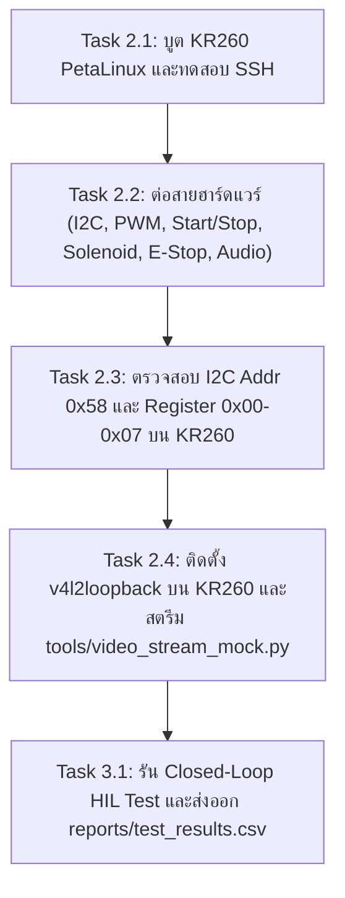

# แผนการพัฒนาและรายงานความคืบหน้า (Project Plan & Progress Tracker)
## โครงการ: Hardware-in-the-Loop (HIL) Testbench with Azure CI/CD for Kria KR260 (GI Detect System)

> **เอกสารสำหรับ AI Agent และ Developers:**  
> เอกสารฉบับนี้เป็น Single Source of Truth สรุปสถานะความคืบหน้าล่าสุด (Current Progress), สถาปัตยกรรมระบบ, การเชื่อมต่อฮาร์ดแวร์, และลำดับงานถัดไป (Next Tasks)

---

## 1. ภาพรวมสถาปัตยกรรมระบบ (System Architecture)

```
+---------------------------------------------------------------------------------+
|                       1. Laptop Host & CI/CD Orchestrator                       |
| - Azure DevOps Self-hosted Agent                                                |
| - Pytest Testbench Controller (USB Serial 115200 Auto-detect)                   |
| - CSV Test Reporting & Metrics Export (reports/test_results.csv)                |
| - Virtual Video Injection Engine (tools/video_stream_mock.py UDP 5000 Ethernet) |
+------------------------+-----------------------------------+--------------------+
                         | (USB Serial Auto-detect)          | (Ethernet / SSH)
                         v                                   v
+----------------------------------------+   +------------------------------------+
| 2. Plant Simulator: STM32H563ZI        |   | 3. Target Under Test (DUT): KR260  |
| (OS: Zephyr RTOS 4.x)                  |   | (OS: Kria Ubuntu / PetaLinux)      |
|                                        |   |                                    |
| [Firmware Components - เสร็จแล้ว 100%] |   | [PL - FPGA Fabric]                 |
| - I2C Target (EEPROM Addr 0x58, 8 Byte)|   | - Custom RTL: pwm_controller.sv    |
|   จำลองเซนเซอร์ความดัน Pressure Sensor |<==+== (Airpump PWM 10-bit + E-Stop)    |
| - Closed-Loop PWM Capture Driver       |   | - Solenoid Valve Output (PE11)     |
|   (src/kr260/kr260_pwm_receiver.c)     |   | - Start/Stop IO Handshake (PB13)   |
| - GI State Machine (Insufflation/Camera)   | - Hardware E-Stop Cutoff (PE9)     |
|   (src/gi_state_machine.c - 6 States)  |   | - ADC / I2S Mic Core (PA4 Leak)    |
| - Audio Leak AC Waveform (PA4/DAC1)    |   | - Vitis AI DPU IP Core             |
|   (src/audio_leak.c - 3 kHz Sine Wave) |   |                                    |
| - GPIO IO Controller (PB13, PE11, PE9) |   | [PS - ARM Cortex-A53]              |
|   (src/io_controller.c - Mock Override)|   | - Vitis AI Inference (GI Detect)   |
| - Zephyr Shell Commands (hil status...)|   | - Audio Leakage Classification     |
| - 20 Hz Simulation & Control Thread    |   | - PID Pressure Controller          |
|                                        |   | - v4l2loopback Virtual Camera      |
|                                        |   | - UI Stream (DisplayPort Output)   |
+----------------------------------------+   +------------------------------------+
```

---

## 2. รายงานความคืบหน้าล่าสุด (Current Progress Breakdown)

### ✅ Phase 1: STM32 Simulator & Test Harness (เสร็จสมบูรณ์ 100%)

1. **Zephyr RTOS I2C Target, State Machine & Subsystems:**
   * [src/main.c](file:///c:/Users/th62034660/Desktop/kria260-stm32-hil-cicd/src/main.c):
     * พัฒนา I2C Target (Slave) Address `0x58` ด้วย `eeprom_target_write_data()` ขนาดขยาย 8 Bytes (0x00 - 0x07)
     * รองรับคำสั่ง Zephyr Shell (`hil status`, `hil set_state`, `hil set_pressure`, `hil inject_leak`, `hil audio_leak`, `hil set_start_stop`, `hil set_estop`, `hil set_solenoid`, `hil reset`, `hil loopback`) ตอบกลับเป็น JSON String
     * มี Simulation Thread ความถี่ 20 Hz (50 ms) คอยอัปเดตโมเดลทางฟิสิกส์, FSM, และ I2C Memory Buffer
   * [src/gi_state_machine.h](file:///c:/Users/th62034660/Desktop/kria260-stm32-hil-cicd/src/gi_state_machine.h) & [src/gi_state_machine.c](file:///c:/Users/th62034660/Desktop/kria260-stm32-hil-cicd/src/gi_state_machine.c):
     * ออกแบบและพัฒนา Finite State Machine (FSM) 6 สถานะสำหรับกระเพาะ/ลำไส้ (GI) และกล้องเอนโดสโคป:
       1. `GI_STATE_IDLE` (`0x00`) - รอนิ่งก่อนการส่องตรวจ
       2. `GI_STATE_INSUFFLATION` (`0x01`) - ปั๊มลมขยายโพรงทางเดินอาหาร
       3. `GI_STATE_STABLE_INSPECTION` (`0x02`) - รักษาระดับความดันคงที่เพื่อตรวจหาพยาธิสภาพ
       4. `GI_STATE_LEAK_EVENT` (`0x03`) - เกิดลมรั่ว ความดันตก พร้อมปล่อยสัญญาณเสียงความถี่สูง
       5. `GI_STATE_DEFLATION_STOP` (`0x04`) - สั่งหยุดและเปิดวาล์วระบายลมออก
       6. `GI_STATE_EMERGENCY_STOP` (`0x05`) - หยุดฉุกเฉิน ตัดไฟปั๊ม ระบายลมทิ้งทันที
     * คำนวณพลศาสตร์ความดัน $dP/dt = (K_{pump} \cdot Duty) - (K_{leak} \cdot Leak) - (K_{vent} \cdot Vent)$
   * [src/audio_leak.h](file:///c:/Users/th62034660/Desktop/kria260-stm32-hil-cicd/src/audio_leak.h) & [src/audio_leak.c](file:///c:/Users/th62034660/Desktop/kria260-stm32-hil-cicd/src/audio_leak.c):
     * สร้างสัญญาณเสียงรั่ว AC Audio Waveform Sine wave ขนาด 16 จุด 12-bit LUT (ความถี่หลัก 3 kHz) ผ่าน DAC1 Channel 1 (พิน `PA4`)
   * [src/io_controller.h](file:///c:/Users/th62034660/Desktop/kria260-stm32-hil-cicd/src/io_controller.h) & [src/io_controller.c](file:///c:/Users/th62034660/Desktop/kria260-stm32-hil-cicd/src/io_controller.c):
     * จัดการสัญญาณ Start/Stop (`PB13`), Solenoid Purge Valve (`PE11`), และ E-Stop (`PE9`) ทั้งจากพินฮาร์ดแวร์จริงและ Software Mock Override
     * รองรับวงจรขับ Solenoid Valve แบบ Normally Open (NO) ผ่าน N-Channel MOSFET: KR260 ส่ง HIGH (3.3V) = ปิดวาล์วกักลม, ส่ง LOW (0V) = เปิดวาล์วระบายลมฉุกเฉิน/Over-Expansion Deflate
   * [app.overlay](file:///c:/Users/th62034660/Desktop/kria260-stm32-hil-cicd/app.overlay): แมปพิน I2C1, I2C2, GPIO Start/Stop, Solenoid, E-Stop, และ PWM Capture
   * [prj.conf](file:///c:/Users/th62034660/Desktop/kria260-stm32-hil-cicd/prj.conf): เปิดใช้งาน CBPRINTF_FP, DAC, GPIO, I2C Target, Zephyr Shell
   * [zephyrRTOS.md](file:///c:/Users/th62034660/Desktop/kria260-stm32-hil-cicd/zephyrRTOS.md): คู่มือเจาะลึกอธิบายสถาปัตยกรรมเฟิร์มแวร์

2. **Pytest Testbench & Host Communication:**
   * [tests/test_hil_stm32.py](file:///c:/Users/th62034660/Desktop/kria260-stm32-hil-cicd/tests/test_hil_stm32.py):
     * เพิ่มระบบ **Auto-detect Serial Port** ข้ามแพลตฟอร์ม (Windows, Linux, macOS)
     * มี Test Suite ครอบคลุม: `test_read_system_status`, `test_manual_pressure_override`, `test_state_machine_transitions`, `test_leak_injection_and_audio`, `test_mock_io_control`, `test_i2c_loopback`
     * บันทึก Telemetry Metrics ละเอียด (`chip_id`, `pressure_kpa`, `pump_duty`, `gi_state`, `leak_audio_active`, `start_stop_io`) เข้าสู่ระบบ CSV Report
   * [tests/conftest.py](file:///c:/Users/th62034660/Desktop/kria260-stm32-hil-cicd/tests/conftest.py): ส่งออกผลทดสอบลงไฟล์ CSV Format (`reports/test_results.csv`)

3. **Virtual Endoscopic Video Stream Engine:**
   * [tools/video_stream_mock.py](file:///c:/Users/th62034660/Desktop/kria260-stm32-hil-cicd/tools/video_stream_mock.py):
     * เครื่องมือกำเนิด Synthetic Endoscopy Video ข้ามสายแลน Ethernet (UDP/RTP H.264 Port 5000)
     * ปรับทัศนียภาพและแสงจำลองในโพรงทางเดินอาหารตามสถานะ FSM อัตโนมัติ (ขยายโพรงเมื่อ Insufflation, ทัศนวิสัยนิ่งเมื่อ Inspection, ภาพกระเพื่อม/ละอองหมอกเมื่อ Leak, ยุบตัวเมื่อ Deflation)
     * วาด On-Screen Display (OSD) แสดงค่าความดัน, สถานะ FSM, ปั๊มลม, และสถานะเสียงรั่วแบบเรียลไทม์

---

### ✅ Phase 2 & RTL: Kria KR260 Hardware & Closed-Loop Integration (เสร็จสมบูรณ์ 100%)

1. **Custom RTL Module สำหรับ KR260 (Airpump PWM Controller):**
   * [hardware/rtl/pwm_controller.sv](file:///c:/Users/th62034660/Desktop/kria260-stm32-hil-cicd/hardware/rtl/pwm_controller.sv):
     * ออกแบบโมดูล SystemVerilog ขับปั๊มลมความละเอียด 10-bit (0 - 1023 ระดับ)
     * รองรับ Clock Prescaler ปรับความถี่ตั้งแต่ 1 kHz ถึง 50 kHz (ค่าเริ่มต้น 9.76 kHz)
     * **ฟีเจอร์ความปลอดภัยระดับเครื่องมือแพทย์:** มีขา `emergency_stop` ทางฮาร์ดแวร์ ตัดไฟปั๊มเหลือ 0% ทันทีในระดับ Logic Gate (Latency $< 10\text{ ns}$)
   * [hardware/rtl/axi_pwm_controller.sv](file:///c:/Users/th62034660/Desktop/kria260-stm32-hil-cicd/hardware/rtl/axi_pwm_controller.sv):
     * โมดูล AXI4-Lite Slave Interface Wrapper ครอบตัว PWM Controller ทำให้ CPU/Linux (PS) สั่งงานและอ่านค่าได้ผ่าน Memory-Mapped Registers (Offset 0x00, 0x04, 0x08, 0x0C)
   * [hardware/xdc/kr260_constraints.xdc](file:///c:/Users/th62034660/Desktop/kria260-stm32-hil-cicd/hardware/xdc/kr260_constraints.xdc):
     * ไฟล์ Physical Constraints แมปพินจริงบนบอร์ด KR260 (I2C RPi Header Pin 3/5, PWM PMOD1 Pin 1, Solenoid PMOD1 Pin 2) ที่ระดับไฟ 3.3V LVCMOS
   * [hardware/sim/tb_pwm_controller.sv](file:///c:/Users/th62034660/Desktop/kria260-stm32-hil-cicd/hardware/sim/tb_pwm_controller.sv):
     * Testbench จำลองการทำงานใน Vivado Simulator (Reset $\rightarrow$ 25% Duty $\rightarrow$ 75% Duty $\rightarrow$ Emergency Stop Assertion $\rightarrow$ Recovery)

2. **STM32 Closed-Loop PWM Capture Receiver Driver:**
   * [src/kr260/kr260_pwm_receiver.h](file:///c:/Users/th62034660/Desktop/kria260-stm32-hil-cicd/src/kr260/kr260_pwm_receiver.h): Header API สำหรับอ่านค่า Duty Cycle, ความถี่, และสถานะการเชื่อมต่อ
   * [src/kr260/kr260_pwm_receiver.c](file:///c:/Users/th62034660/Desktop/kria260-stm32-hil-cicd/src/kr260/kr260_pwm_receiver.c):
     * ใช้สถาปัตยกรรม **Dual-Edge GPIO Interrupt** ร่วมกับ **DWT Hardware Cycle Counter (250 MHz)** วัด Pulse Width ได้แม่นยำระดับนาโนวินาที
     * มี Glitch & Noise Rejection Filter
     * มี **Safety Watchdog Thread** ตรวจจับกรณีสัญญาณหยุดนิ่ง (ค้างที่ 0% หรือ 100%) หากไม่มี Edge เข้ามาเกิน 100 ms

3. **คู่มือวิศวกรรมสำหรับทีมพัฒนา (Documentation in `howto/`):**
   * [howto/kr260_vivado_design_guide.md](file:///c:/Users/th62034660/Desktop/kria260-stm32-hil-cicd/howto/kr260_vivado_design_guide.md): คู่มือ Step-by-Step การสร้าง Vivado Block Design เริ่มต้น (Zynq MPSoC, AXI IIC, PWM Pump, GPIO Valve, XDC Constraints)
   * [howto/kr260_bringup_and_flash_guide.md](file:///c:/Users/th62034660/Desktop/kria260-stm32-hil-cicd/howto/kr260_bringup_and_flash_guide.md): คู่มือการ Bring-up บอร์ด KR260 ด้วย PetaLinux และกลยุทธ์การ Flash สำหรับ CI/CD (เปรียบเทียบ PL vs PS vs Boot Image)

---

## 3. ตารางการเชื่อมต่อฮาร์ดแวร์จริง (Wiring Map)

| สัญญาณ | ฝั่ง Kria KR260 (DUT) | ฝั่ง STM32H563ZI (Simulator) | หน้าที่ทางวิศวกรรม |
|---|---|---|---|
| **I2C SCL** | Raspberry Pi Header **Pin 5** (`AC14`) | Arduino Header **D15** (`PB8`) | บัส Master อ่าน Register 0x00-0x07 จาก STM32 Slave (0x58) |
| **I2C SDA** | Raspberry Pi Header **Pin 3** (`AD14`) | Arduino Header **D14** (`PB9`) | ข้อมูล I2C Data 100 kHz |
| **Airpump PWM**| PMOD 1 **Pin 1** (`H12`) | Arduino Header **D2** (`PF15`) | KR260 ขับ PWM สั่งปั๊มลม $\rightarrow$ STM32 วัดไปคำนวณความดัน |
| **Start/Stop IO** | PMOD 1 **Pin 3** (`H11`) | Arduino Header **D3** (`PB13`) | สัญญาณสั่งเริ่ม/หยุดกระบวนการจาก KR260 |
| **Solenoid Valve**| PMOD 1 **Pin 2** (`E10`) | Arduino Header **D4** (`PE11`) | สัญญาณสั่งเปิด/ปิดวาล์วระบายลม (Vent Valve) |
| **E-Stop Cutoff** | PMOD 1 **Pin 4** (`J10`) | Arduino Header **D5** (`PE9`) | สัญญาณตัดการทำงานฉุกเฉินระดับฮาร์ดแวร์ |
| **Leak Audio AC** | PMOD 2 **Pin 1** (ADC In) / Audio In | Arduino Header **A2** (`PA4`) | สัญญาณเสียงลมรั่ว AC 3 kHz Sine wave จาก DAC1 Ch1 |
| **Video Stream** | Ethernet Port (`eth0`) | Host PC / Testbench Ethernet | สตรีมวิดีโอจำลองกล้องเอนโดสโคป UDP/RTP H.264 Port 5000 |
| **Common GND** | PMOD Pin 5/11 หรือ RPi Pin 6 (**GND**) | Arduino Header **GND** | **ต้องต่อร่วมกันเสมอ (Common Ground Reference)** |

---

## 4. สิ่งที่ต้องทำต่อไป (Next Actionable Tasks)



* [ ] **Task 2.1: เตรียมบอร์ด Kria KR260**
  * เขียนอิมเมจ PetaLinux ลง MicroSD Card เสียบเข้า KR260 และเปิดเครื่อง
  * เสียบสาย LAN เข้า Router/Laptop และทดสอบ SSH: `ssh petalinux@<KR260_IP>`
* [ ] **Task 2.2: เชื่อมต่อสาย Jumper ตามตาราง Wiring Map**
  * SCL (`PB8` $\leftrightarrow$ RPi Pin 5)
  * SDA (`PB9` $\leftrightarrow$ RPi Pin 3)
  * PWM (`PF15` $\leftrightarrow$ PMOD1 Pin 1)
  * Start/Stop (`PB13` $\leftrightarrow$ PMOD1 Pin 3)
  * Solenoid Valve (`PE11` $\leftrightarrow$ PMOD1 Pin 2)
  * E-Stop (`PE9` $\leftrightarrow$ PMOD1 Pin 4)
  * Leak Audio (`PA4` $\leftrightarrow$ Audio / ADC In)
  * GND (`GND` $\leftrightarrow$ `GND`)
* [ ] **Task 2.3: ทดสอบ First Handshake ข้ามบอร์ด**
  * รัน `sudo i2cdetect -y -r 1` บน KR260 ต้องพบ Address `0x58`
  * รันสคริปต์ `pressure_sensor.py` อ่านค่าทั้ง 8 ไบต์ (Chip ID, Status, Pressure, State, Duty, Target, IO)
* [ ] **Task 2.4: ติดตั้งและทดสอบ Video Injection บน KR260**
  * รัน `sudo modprobe v4l2loopback video_nr=10`
  * รันสคริปต์ `python tools/video_stream_mock.py --target-ip <KR260_IP>` สตรีมภาพกล้องเอนโดสโคปเสมือนเข้า `/dev/video10`
* [ ] **Task 3.1: รัน End-to-End Pytest HIL และตรวจสอบ CSV Report**
  * รัน `python -m pytest tests/test_hil_stm32.py --csv=reports/test_results.csv`
  * ตรวจสอบผลทดสอบและค่า Telemetry metrics ใน `reports/test_results.csv`
