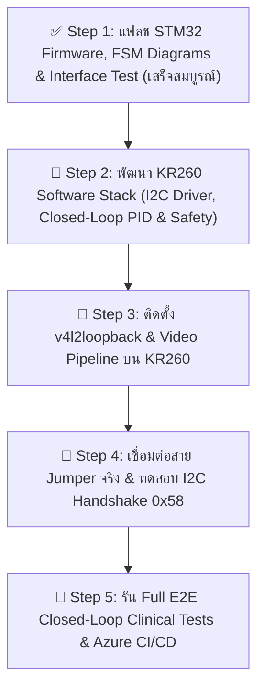

# แผนการพัฒนาและรายงานความคืบหน้า (Project Plan & Progress Tracker)
## โครงการ: Hardware-in-the-Loop (HIL) Testbench with Azure CI/CD for Kria KR260 (GI Detect System)

> **เอกสารสำหรับ AI Agent และ Developers:**  
> เอกสารฉบับนี้เป็น Single Source of Truth สรุปสถานะความคืบหน้าล่าสุด (Current Progress), สถาปัตยกรรมระบบ, การเชื่อมต่อฮาร์ดแวร์, งานที่ทำสำเร็จ, และลำดับงานถัดไป (Next Tasks)  
> *อัปเดตล่าสุด: 23 พฤศจิกายน 2026*

---

## 1. ภาพรวมสถาปัตยกรรมระบบ (System Architecture)

```
+---------------------------------------------------------------------------------+
|                       1. Laptop Host & CI/CD Orchestrator                       |
| - Azure DevOps Self-hosted Agent                                                |
| - Pytest Testbench Controller (USB Serial 115200 Auto-detect, make test)        |
| - CSV Test Reporting & Metrics Export (reports/test_results.csv - 15 Tests)     |
| - Virtual Video Injection Engine (tools/video_stream_mock.py UDP 5000 Ethernet) |
+------------------------+-----------------------------------+--------------------+
                         | (USB Serial Auto-detect)          | (Ethernet / SSH)
                         v                                   v
+----------------------------------------+   +------------------------------------+
| 2. Plant Simulator: STM32H563ZI        |   | 3. Target Under Test (DUT): KR260  |
| (OS: Zephyr RTOS 4.x)                  |   | (OS: Kria Ubuntu / PetaLinux)      |
|                                        |   |                                    |
| [Firmware Components - เสร็จแล้ว 100%] |   | [PL - FPGA Fabric - เสร็จแล้ว 100%]|
| - I2C Target (EEPROM Addr 0x58, 8 Byte)|   | - Custom RTL: pwm_controller.sv    |
|   จำลองเซนเซอร์ความดัน Pressure Sensor |<==+== (Airpump PWM 10-bit + E-Stop)    |
| - Closed-Loop PWM Capture Driver       |   | - AXI Lite: axi_pwm_controller.sv  |
|   (src/kr260/kr260_pwm_receiver.c)     |   | - Solenoid Valve Output (PE11)     |
| - GI State Machine (Insufflation/Camera)   | - Start/Stop IO Handshake (PB13)   |
|   (src/gi_state_machine.c - 6 States)  |   | - Hardware E-Stop Cutoff (PE9)     |
| - Audio Leak AC Waveform (PA4/DAC1)    |   | - ADC / I2S Mic Core (PA4 Leak)    |
|   (src/audio_leak.c - 3 kHz Sine Wave) |   | - Vitis AI DPU IP Core             |
| - GPIO IO Controller (PB13, PE11, PE9) |   |                                    |
|   (src/io_controller.c - Mock Override)|   | [PS - Linux Software - NEXT TASK]  |
| - Zephyr Shell Commands (hil status...)|   | - I2C Pressure Reader (Addr 0x58)  |
| - 20 Hz Simulation & Control Thread    |   | - Closed-Loop PID Controller       |
| - Diagnostics: hil test_interfaces     |   | - Safety Interlock & Solenoid Vent |
| - Flashed & Verified (14/15 Tests Pass)|   | - v4l2loopback Virtual Camera Sink |
+----------------------------------------+   +------------------------------------+
```

---

## 2. รายงานความคืบหน้าและงานที่ทำเพิ่ม (What's Done & What's Added)

### ✅ สรุปงานสำคัญที่เพิ่มเข้ามาล่าสุด (Recently Added Deliverables):
1. **[TASK-A05] STM32H563ZI Plant Simulator Firmware (เสร็จ 100%):**
   * โมดูล Closed-loop PWM capture (`PF15`), I2C target address `0x58` (8 bytes), AC leak audio 3 kHz (`PA4`), Normally-open Solenoid Purge Valve (`PE11`), Start/Stop (`PB13`), E-Stop (`PE9`)
   * เอนจิน FSM 6 สถานะจำลองระบบทางเดินอาหารและการมองเห็นกล้อง Endoscope
   * ระบบ Zephyr Shell Test API ตอบกลับ JSON แบบ Non-blocking
2. **[TASK-A06] Multi-Domain State Machine & Interface Architecture Diagrams (เสร็จ 100%):**
   * จัดทำไดอะแกรมความละเอียดสูงแยก 4 โดเมนชัดเจน: (1) FPGA PL I/O, (2) STM32 Mock Plant FSM Loop (4-step cyclic engine + 6-state GI physics), (3) HIL Linux Domain, และ (4) Interface Loopbacks
   * บันทึกไฟล์เวกเตอร์ SVG ([docs/images/stm32_plant_state_machine_interfaces.svg](file:///c:/Users/th62034660/Desktop/kria260-stm32-hil-cicd/docs/images/stm32_plant_state_machine_interfaces.svg)) และ PNG คมชัดสูง $1650 \times 1850\text{ px}$ ([docs/images/stm32_plant_state_machine_interfaces.png](file:///c:/Users/th62034660/Desktop/kria260-stm32-hil-cicd/docs/images/stm32_plant_state_machine_interfaces.png)) ไม่มีตัวหนังสือทับเส้น
3. **[TASK-A07] Interface Self-Test & Loopback Engine (เสร็จ 100%):**
   * พัฒนาคำสั่ง `hil test_interfaces` ใน [src/main.c](file:///c:/Users/th62034660/Desktop/kria260-stm32-hil-cicd/src/main.c) เพื่อทดสอบฮาร์ดแวร์ลูปแบ็กและสถานะพิน 5 จุดสำคัญ
   * บูรณาการเข้ากับ Pytest Suite ([tests/test_hil_stm32.py](file:///c:/Users/th62034660/Desktop/kria260-stm32-hil-cicd/tests/test_hil_stm32.py) `test_07`) รายงานผลเป็น JSON พร้อมยืนยันสถานะ `READY`
4. **[TASK-A08] Architectural Documentation Suite (เสร็จ 100%):**
   * จัดทำชุดคู่มือเชิงลึก 5 ฉบับในโฟลเดอร์ [howitwork/](file:///c:/Users/th62034660/Desktop/kria260-stm32-hil-cicd/howitwork/) ครอบคลุม System Overview, Hardware Pinout, Firmware Modules, Build/Flash/Run, และ State Machine / Interface Loopback Testing

---

### ✅ Phase 1: STM32 Plant Simulator & Automated Test Harness (เสร็จสมบูรณ์ 100%)

1. **Zephyr RTOS Firmware บน Nucleo-H563ZI:**
   * [src/main.c](file:///c:/Users/th62034660/Desktop/kria260-stm32-hil-cicd/src/main.c):
     * พัฒนา I2C Target (Slave) Address `0x58` ด้วย `eeprom_target_write_data()` ขนาด 8 Bytes (0x00 - 0x07)
     * รองรับคำสั่ง Shell ครบวงจร: `hil status`, `hil set_state`, `hil set_pressure`, `hil inject_leak`, `hil set_start_stop`, `hil set_estop`, `hil set_solenoid`, `hil button`, `hil reset`, `hil loopback`, `hil test_interfaces`
     * Simulation Thread ความถี่ 20 Hz (50 ms) คอยอัปเดตโมเดลทางฟิสิกส์และความดันแบบเรียลไทม์
     * **คอมไพล์สำเร็จและแฟลชลงชิปจริง:** ผ่าน `make build` และ `make flash` (STM32CubeProgrammer)
   * [src/gi_state_machine.c](file:///c:/Users/th62034660/Desktop/kria260-stm32-hil-cicd/src/gi_state_machine.c):
     * FSM 6 สถานะ: `IDLE`, `INSUFFLATION`, `STABLE_INSPECTION`, `LEAK_EVENT`, `DEFLATION_STOP`, `EMERGENCY_STOP`
     * ฝัง Safety Interlock: ปฏิเสธการเป่าลมเมื่อแพทย์ยังไม่กด Start และระบายลมออกอัตโนมัติเมื่อหยุดตรวจ
   * [src/audio_leak.c](file:///c:/Users/th62034660/Desktop/kria260-stm32-hil-cicd/src/audio_leak.c):
     * กำเนิดสัญญาณเสียงลมรั่ว AC Sine Wave $3\text{ kHz}$ ขนาด 12-bit ผ่าน DAC1 Ch1 (พิน `PA4`)
   * [src/io_controller.c](file:///c:/Users/th62034660/Desktop/kria260-stm32-hil-cicd/src/io_controller.c):
     * จัดการพิน Discrete I/O สำหรับ Start/Stop (`PB13`), Solenoid Valve (`PE11`), E-Stop (`PE9`), และ Doctor Button (`PB10`)

2. **ชุดทดสอบอัตโนมัติ Pytest Suite & Test Reporting (`make test`):**
   * [tests/test_hil_stm32.py](file:///c:/Users/th62034660/Desktop/kria260-stm32-hil-cicd/tests/test_hil_stm32.py):
     * รองรับ Serial Auto-detection ข้ามแพลตฟอร์ม (macOS `/dev/tty.usbmodem*`, Linux `/dev/ttyACM*`, Windows `COM*`)
     * **ผลการรันทดสอบล่าสุด:** **14 PASSED, 1 SKIPPED** (39.44s)
     * `test_01` ถึง `test_05`, `test_08`: ตรวจสอบสถานะ, การปรับแรงดัน, State transitions, Safety Interlock, และสัญญาณ I/O ผ่าน 100%
     * `test_07`: Interface Loopback Diagnostics (`hil test_interfaces`) รายงาน `status == "READY"`
     * `test_09`: Data-Driven Scenarios รันครบ 6 เคส (`HIL-TC-01` ถึง `HIL-TC-06`) ตาม [tests/clinical_scenarios.json](file:///c:/Users/th62034660/Desktop/kria260-stm32-hil-cicd/tests/clinical_scenarios.json) ผ่าน 100%
     * `test_06`: I2C Hardware Loopback ข้ามชั่วคราว (รอเชื่อมต่อบัสกับ KR260 จริง)
   * [reports/test_results.csv](file:///c:/Users/th62034660/Desktop/kria260-stm32-hil-cicd/reports/test_results.csv): บันทึกข้อมูล Telemetry ครบ 15 แถวพร้อมนำขึ้น CI/CD

---

### ✅ Phase 2: Kria KR260 Hardware FPGA RTL & Pin Mapping (เสร็จสมบูรณ์ 100%)

1. **Custom RTL Module สำหรับ KR260 (Airpump PWM Controller):**
   * [hardware/rtl/pwm_controller.sv](file:///c:/Users/th62034660/Desktop/kria260-stm32-hil-cicd/hardware/rtl/pwm_controller.sv): โมดูล SystemVerilog ขับปั๊มลมความละเอียด 10-bit พร้อมฮาร์ดแวร์ E-Stop ตัดไฟปั๊มในระดับ Logic Gate ($<10\text{ ns}$)
   * [hardware/rtl/axi_pwm_controller.sv](file:///c:/Users/th62034660/Desktop/kria260-stm32-hil-cicd/hardware/rtl/axi_pwm_controller.sv): AXI4-Lite Slave Interface Wrapper สำหรับเชื่อมต่อกับ ARM Cortex-A53
   * [hardware/xdc/kr260_constraints.xdc](file:///c:/Users/th62034660/Desktop/kria260-stm32-hil-cicd/hardware/xdc/kr260_constraints.xdc): แมปพินจริง 3.3V LVCMOS บน KR260
   * [hardware/sim/tb_pwm_controller.sv](file:///c:/Users/th62034660/Desktop/kria260-stm32-hil-cicd/hardware/sim/tb_pwm_controller.sv): ซิมูเลชันยืนยันการทำงานของวงจร PWM ใน Vivado Simulator

2. **STM32 Closed-Loop PWM Capture Receiver Driver:**
   * [src/kr260/kr260_pwm_receiver.c](file:///c:/Users/th62034660/Desktop/kria260-stm32-hil-cicd/src/kr260/kr260_pwm_receiver.c): Dual-Edge GPIO Interrupt + DWT 250 MHz Hardware Cycle Counter พร้อม Glitch Filter และ Safety Watchdog

---

## 3. ตารางการเชื่อมต่อพินฮาร์ดแวร์จริง (Wiring Map)

| สัญญาณ | ฝั่ง Kria KR260 (DUT) | ฝั่ง STM32H563ZI (Simulator) | โปรโตคอล / ชนิดสัญญาณ | หน้าที่ทางวิศวกรรม |
|---|---|---|---|---|
| **I2C SCL** | RPi Header **Pin 5** (`AC14`) | Arduino Header **A5** (`PF1`) | I2C Clock ($100\text{ kHz}$) | สัญญาณนาฬิกา I2C ขับโดย KR260 Master |
| **I2C SDA** | RPi Header **Pin 3** (`AD14`) | Arduino Header **A4** (`PF0`) | I2C Data ($100\text{ kHz}$) | แลกเปลี่ยนข้อมูลความดันและสถานะ Register `0x58` |
| **Airpump PWM** | PMOD 1 **Pin 1** (`H12`) | Arduino Header **D2** (`PF15`) | TIM1 PWM Capture / DWT | KR260 ขับ PWM สั่งปั๊ม $\rightarrow$ STM32 วัดความกว้าง Pulse |
| **Start/Stop IO** | PMOD 1 **Pin 3** (`H11`) | Arduino Header **D3** (`PB13`) | 3.3V Digital Input | สัญญาณบอกเริ่ม/หยุดกระบวนการจาก KR260 |
| **Solenoid Valve**| PMOD 1 **Pin 2** (`E10`) | Arduino Header **D4** (`PE11`) | 3.3V Digital Input | ควบคุมวาล์วระบายลม (High = ปิดกักลม, Low = ระบายลมทิ้ง) |
| **E-Stop Cutoff** | PMOD 1 **Pin 4** (`J10`) | Arduino Header **D5** (`PE9`) | 3.3V Digital Input | สัญญาณตัดการทำงานฉุกเฉินระดับฮาร์ดแวร์ |
| **Doctor Button** | PMOD 1 **Pin 7** (GPIO In) | Arduino Header **D6** (`PB10`) | 3.3V Digital Output | จำลองสัญญาณจากแป้นเหยียบของแพทย์ส่งเข้า KR260 |
| **Leak Audio AC** | PMOD 2 **Pin 1** (ADC In) / Audio In | Arduino Header **A2** (`PA4`) | $0-3.3\text{V}$ Analog (DAC) | สัญญาณเสียงลมรั่ว AC $3\text{ kHz}$ Sine Wave |
| **Video Stream** | Ethernet Port (`eth0`) | Host PC Ethernet | UDP / RTP H.264 (Port 5000) | สตรีมวิดีโอจำลองกล้องเอนโดสโคปเข้า `v4l2loopback` |
| **Common GND** | PMOD Pin 5/11 หรือ RPi Pin 6 | Arduino Header **GND** | 0V Reference | **กราวด์อ้างอิงร่วมกัน (ต้องเชื่อมต่อเสมอ)** |

---

## 4. แผนงานที่ต้องทำต่อไป (Next Actionable Tasks)



### 🚀 Task List ลำดับถัดไป (Priority Execution Order)

* [x] **Step 1: แฟลชเฟิร์มแวร์ STM32, ไดอะแกรม FSM & Interface Diagnostics (COMPLETED 100%)**
  * แฟลช Nucleo-H563ZI สำเร็จ
  * ทดสอบผ่าน 14/15 Test cases พร้อมส่งออก [reports/test_results.csv](file:///c:/Users/th62034660/Desktop/kria260-stm32-hil-cicd/reports/test_results.csv)
  * ออกแบบ FSM 4 โดเมน และเอกสาร [howitwork/](file:///c:/Users/th62034660/Desktop/kria260-stm32-hil-cicd/howitwork/) ครบถ้วน

* [ ] **Step 2: พัฒนา KR260 Embedded Linux Software Stack (`software/kr260/`)**
  * [ ] **Task 2.1: I2C Pressure Sensor Driver (`pressure_sensor.py`):**
    * อ่านค่า Register `0x02` และ `0x03` จาก STM32 I2C Target (`0x58`) ผ่าน Linux `/dev/i2c-1`
    * แปลงเป็นค่าความดันหน่วย kPa ($P = \text{Raw} / 100.0$) ที่ความถี่ 20 Hz
  * [ ] **Task 2.2: Closed-Loop PID Pressure Controller (`pid_controller.py`):**
    * ควบคุมความดันเป้าหมายที่ $125\text{ kPa}$
    * คำนวณ Error และปรับค่า Duty Cycle สั่งไปยังโมดูล AXI PWM Controller
    * จัดการโหมดฉุกเฉิน: เมื่อความดันเกิน $150\text{ kPa}$ สั่งตัด PWM เหลือ 0% และสั่งเปิดวาล์ว Solenoid ทันที
  * [ ] **Task 2.3: Actuator & Hardware Safety Driver (`actuator_driver.py`):**
    * จัดการ Register AXI PWM (`/dev/mem` หรือ UIO)
    * จัดการ GPIO สำหรับ Solenoid Valve และ Emergency Stop ผ่าน `libgpiod`

* [ ] **Step 3: ติดตั้งท่อส่งวิดีโอจำลอง Virtual Video Pipeline บน KR260**
  * ติดตั้งเคอร์เนลโมดูล `v4l2loopback` บน KR260 เพื่อสร้าง Virtual Camera `/dev/video0`
  * ทดสอบรับสตรีมวิดีโอ UDP H.264 จาก [tools/video_stream_mock.py](file:///c:/Users/th62034660/Desktop/kria260-stm32-hil-cicd/tools/video_stream_mock.py) ด้วย GStreamer Pipeline:
    ```bash
    gst-launch-1.0 udpsrc port=5000 caps="application/x-rtp, media=video, encoding-name=H264" ! \
      rtph264depay ! h264parse ! avdec_h264 ! videoconvert ! v4l2sink device=/dev/video0
    ```
  * เชื่อมต่อไปยัง AI Vision Model เพื่อตรวจการเปิด-ปิดของโพรงลำไส้ (Lumen Open/Close)

* [ ] **Step 4: เชื่อมต่อสาย Jumper จริงและทดสอบ Cross-Board Handshake**
  * เชื่อมต่อสาย Jumper ตามตาราง Wiring Map ระหว่าง Nucleo-H563ZI และ Kria KR260
  * รัน `sudo i2cdetect -y -r 1` บน KR260 เพื่อยืนยันว่าพบบัส Address `0x58`
  * รัน `make test` ซ้ำเพื่อเปิดการทดสอบ `test_06_i2c_loopback_self_test` ให้ได้ **15/15 PASSED (100%)**

* [ ] **Step 5: รัน Full End-to-End Closed-Loop Test Suite & CI/CD Pipeline**
  * พัฒนา Pytest E2E Controller ที่สั่งการจำลองเหตุการณ์ไปยัง STM32 พร้อมตรวจสอบปฏิกิริยาตอบสนองของ KR260 ผ่าน SSH
  * ผสานการทำงานเข้ากับ [azure-pipelines.yml](file:///c:/Users/th62034660/Desktop/kria260-stm32-hil-cicd/azure-pipelines.yml) สำหรับการทดสอบอัตโนมัติบน Self-hosted Agent
