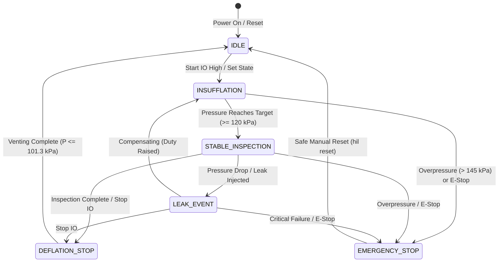

# คู่มือการทำงานของเฟิร์มแวร์ STM32H563ZI (Zephyr RTOS Plant Simulator)

เอกสารฉบับนี้อธิบายหลักการทำงานภายใน สถาปัตยกรรมระดับซอร์สโค้ด และขั้นตอนการคอมไพล์ แฟลช และรันเฟิร์มแวร์บนบอร์ด **STM32 Nucleo-H563ZI** ภายใต้ระบบปฏิบัติการเรียลไทม์ **Zephyr RTOS 4.x**

---

## 1. หลักการทำงานภายใน (Internal Mechanics)

เฟิร์มแวร์ STM32 ทำหน้าที่เป็น **Plant Simulator & Sensor Mocking Subsystem** จำลองสภาพแวดล้อมทางเดินอาหาร (Gastrointestinal Cavity), เซนเซอร์วัดแรงดัน, เสียงลมรั่ว, และรับคำสั่งควบคุมจาก Kria KR260

```
                      +---------------------------------------+
                      |       Zephyr Kernel Scheduler         |
                      +-------------------+-------------------+
                                          |
        +---------------------------------+---------------------------------+
        |                                 |                                 |
        v                                 v                                 v
+-----------------------+     +-----------------------+     +-----------------------+
| 1. Simulation Thread  |     | 2. Audio Leak Thread  |     | 3. PWM Watchdog Thread|
| - ความถี่: 20 Hz      |     | - ความถี่: DAC Stream |     | - ความถี่: 20 Hz      |
| - อัปเดต GI State     |     | - สร้าง Sine Wave 3kHz|     | - ตรวจจับกรณีสัญญาณขาด |
| - คำนวณความดัน dP/dt  |     | - ขับออกขา PA4 (DAC1) |     | - ป้องกัน Timeout     |
| - อัปเดต I2C 8 ไบต์   |     +-----------------------+     +-----------------------+
+-----------------------+
        |                                 ^                                 ^
        v                                 |                                 |
+-----------------------------------------------------------------------------------+
|                        Hardware Peripherals & Interfacing                         |
| • I2C1 Target (0x58): PB8 (SCL), PB9 (SDA)  • PWM Capture: PF15 (Arduino D2)     |
| • DAC1 Channel 1: PA4 (Arduino A2)          • IO Inputs: PB13, PE11, PE9 (D3-D5)  |
| • Zephyr Shell (USB CDC Serial 115200 8N1): รับคำสั่ง JSON Testbench APIs         |
+-----------------------------------------------------------------------------------+
```

---

### 1.1 Finite State Machine: ระบบทางเดินอาหารและกล้องจำลอง (`src/gi_state_machine.c`)

ระบบจำลองประกอบด้วย 6 สถานะหลักตามวงรอบการส่องกล้องตรวจรักษา:



#### รายละเอียดสถานะ:
1. **`GI_STATE_IDLE` (`0x00`):**
   * สถานะเริ่มต้น ความดันอยู่ที่ระดับบรรยากาศ ($101.325\text{ kPa}$)
   * ปั๊มลมและวาล์วปิดสนิท ทัศนียภาพของกล้องเอนโดสโคปปิดมืด
2. **`GI_STATE_INSUFFLATION` (`0x01`):**
   * เริ่มปั๊มก๊าซเพื่อขยายโพรงทางเดินอาหาร
   * ทัศนียภาพของกล้องเริ่มขยายตัวและมองเห็นลวดลายเยื่อบุกระเพาะ
3. **`GI_STATE_STABLE_INSPECTION` (`0x02`):**
   * ความดันคงที่ที่ระดับเป้าหมาย (เช่น $120.0\text{ kPa}$)
   * โพรงทางเดินอาหารเปิดนิ่ง เสถียร พร้อมสำหรับการประมวลผล AI ตรวจจับติ่งเนื้อ (Polyp Detection)
4. **`GI_STATE_LEAK_EVENT` (`0x03`):**
   * เกิดรอยรั่วในระบบ ความดันเริ่มตกลงอย่างรวดเร็ว
   * **เปิดใช้งานสัญญาณเสียงลมรั่ว AC Waveform (3 kHz)** ส่งออกไปที่พิน `PA4`
   * ภาพจากกล้องจำลองจะกระเพื่อมและมีละอองก๊าซบดบังบางส่วน
5. **`GI_STATE_DEFLATION_STOP` (`0x04`):**
   * สิ้นสุดการตรวจรักษา สั่งเปิดวาล์ว Solenoid Purge Valve เพื่อระบายก๊าซทิ้ง
   * ภาพจากกล้องจำลองจะยุบตัวลงอย่างช้าๆ จนกลับสู่ระดับปกติ
6. **`GI_STATE_EMERGENCY_STOP` (`0x05`):**
   * กรณีฉุกเฉิน (แรงดันเกิน $145\text{ kPa}$ หรือได้รับสัญญาณ E-Stop ทางฮาร์ดแวร์)
   * ตัดไฟปั๊มเหลือ 0% ทันที และเปิดวาล์วระบายลมฉุกเฉิน

---

### 1.2 สมการพลศาสตร์ความดัน (Pressure Differential Equation)

ในฟังก์ชัน `gi_sm_step_simulation()` มีการคำนวณการเปลี่ยนแปลงความดันทุกๆ 50 ms ($\Delta t = 0.05\text{ s}$):

$$\frac{dP}{dt} = \left( K_{pump} \cdot \text{Duty} \right) - \left( K_{leak} \cdot \text{Leak} \right) - \left( K_{vent} \cdot \text{Vent} \right)$$

* $K_{pump} = 0.15\text{ kPa/s / %Duty}$: อัตราการเพิ่มแรงดันตามเปอร์เซ็นต์ปั๊มลม
* $K_{leak} = 15.0\text{ kPa/s}$: อัตราการสูญเสียแรงดันเมื่อมีรอยรั่ว
* $K_{vent} = 20.0\text{ kPa/s}$: อัตราการระบายแรงดันเมื่อเปิดโซลินอยด์วาล์ว
* อุณหภูมิและความดันพื้นฐาน $P_{atm} = 101.325\text{ kPa}$

---

### 1.3 ระบบวัดความถี่และ Duty Cycle จาก KR260 (`src/kr260/kr260_pwm_receiver.c`)

* ทำงานโดยใช้ **GPIO Interrupt (Both Edges)** บนขา `PF15` (Arduino D2)
* จับเวลาความกว้างของพัลส์ (Pulse Width) ด้วย **ARM Cortex-M33 DWT Hardware Cycle Counter (250 MHz)**
* ความแม่นยำในการวัดสูงถึงระดับ **4 นาโนวินาทีต่อ Cycle**:
  $$\text{Duty Cycle (\%)} = \frac{T_{high}}{T_{period}} \times 100\%$$
* มี Watchdog Thread คอยตรวจเช็กหากไม่มีขอบสัญญาณเข้ามานานเกิน 100 ms จะตัดสินใจว่าสัญญาณค้างที่ 0% หรือ 100% ป้องกันระบบค้าง

---

### 1.4 โครงสร้าง I2C Target EEPROM Memory Map (`0x58`)

STM32 ตั้งค่าเป็นอุปกรณ์ I2C Target Address `0x58` ความเร็ว 100 kHz (I2C1 บนพิน `PB8`/`PB9`) โดยมีโครงสร้างข้อมูล 8 ไบต์ดังนี้:

| Register Offset | ชื่อข้อมูล (Field) | ขนาด | รูปแบบและคำอธิบาย |
|---|---|---|---|
| `0x00` | **Chip ID** | 1 Byte | ค่าคงที่ `0x58` สำหรับระบุตัวตน |
| `0x01` | **Status Flags** | 1 Byte | Bitfield:<br>• Bit 0: `Leak Active` (1 = กำลังรั่ว)<br>• Bit 1: `Valve Open` (1 = วาล์วเปิดระบาย)<br>• Bit 2: `Overpressure` (1 = แรงดันเกินเกณฑ์)<br>• Bit 3: `E-Stop Active` (1 = หยุดฉุกเฉิน) |
| `0x02` | **Pressure MSB** | 1 Byte | ส่วนไบต์บนของค่าความดัน |
| `0x03` | **Pressure LSB** | 1 Byte | ส่วนไบต์ล่างของค่าความดัน<br>$\text{Pressure (kPa)} = \frac{(\text{MSB} \ll 8) \mid \text{LSB}}{100.0}$ |
| `0x04` | **GI State** | 1 Byte | รหัสสถานะปัจจุบัน (`0x00` ถึง `0x05`) |
| `0x05` | **Pump Duty** | 1 Byte | เปอร์เซ็นต์ปั๊มลมที่วัดได้ (0 - 100 %) |
| `0x06` | **Target Pressure** | 1 Byte | ความดันเป้าหมายที่ตั้งไว้ (หน่วย kPa) |
| `0x07` | **IO Status** | 1 Byte | Bitfield ขาฮาร์ดแวร์:<br>• Bit 0: `Start/Stop`<br>• Bit 1: `Solenoid`<br>• Bit 2: `E-Stop` |

---

### 1.5 เครื่องกำเนิดเสียงลมรั่ว AC Audio Generator (`src/audio_leak.c`)

* ใช้ทรัพยากร **DAC1 Channel 1** บนขา `PA4` (Arduino Header A2)
* ทำงานด้วยตารางค่า Sine Wave 16 จุด ความละเอียด 12-bit (0 - 4095) กึ่งกลางที่ 2048:
  ```c
  static const uint16_t sine_lut[16] = {
      2048, 2831, 3495, 3939, 4095, 3939, 3495, 2831,
      2048, 1264,  600,  156,     0,  156,  600, 1264
  };
  ```
* เมื่อสถานะเปลี่ยนเป็น `GI_STATE_LEAK_EVENT` หรือคำสั่ง `hil inject_leak 1` ทำงาน เธรดเสียงจะปล่อยคลื่นความถี่ $\approx 3\text{ kHz}$ ออกไปอย่างต่อเนื่อง เพื่อให้ขา Audio/ADC ของ KR260 นำไปจำแนกเสียงด้วย AI

---

### 1.6 ระบบ Zephyr Shell & UART Testbench API

คำสั่ง Shell ภายใต้ Root Command `hil` ผ่านพอร์ต USB Serial (115200 8N1):

```bash
uart:~$ hil status
{"chip_id": "0x58", "state": "INSPECT", "state_id": 2, "pressure_kpa": 120.45, "target_kpa": 120.00, "pump_duty": 45.20, "leak": false, "leak_audio": false, "valve_open": false, "estop": false, "io_start_stop": true, "io_solenoid": false, "io_estop": false, "camera_scene": "STABLE_INSPECTION"}

uart:~$ hil set_state INSUFFLATE
{"status": "OK", "new_state": "INSUFFLATE", "state_id": 1}

uart:~$ hil set_pressure 125.0
{"status": "OK", "target_pressure_kpa": 125.00}

uart:~$ hil inject_leak 1
{"status": "OK", "leak_injected": true, "audio_ac_active": true}

uart:~$ hil set_start_stop 1
{"status": "OK", "mock_start_stop": true}

uart:~$ hil set_estop 0
{"status": "OK", "mock_estop": false}

uart:~$ hil reset
{"status": "OK", "action": "system_reset_to_idle"}
```

---

## 2. ขั้นตอนการคอมไพล์ แฟลช และรัน (Build, Flash & Run Guide)

### 2.1 สิ่งที่ต้องเตรียม (Prerequisites)
1. ติดตั้ง **Zephyr SDK** (v0.16.x หรือใหม่กว่า) และเครื่องมือ `west`
2. บอร์ด **STM32 Nucleo-H563ZI** ต่อสาย Micro-USB/USB-C เข้ากับคอมพิวเตอร์
3. ไดรเวอร์ ST-Link Virtual COM Port

---

### 2.2 การคอมไพล์เฟิร์มแวร์ (Building the Firmware)

เปิด Terminal หรือ Command Prompt ในโฟลเดอร์โปรเจกต์:

```bash
# ตรวจสอบ Environment ของ Zephyr
west --version

# สั่ง Build สำหรับบอร์ด Nucleo-H563ZI แบบ Clean Build
west build -b nucleo_h563zi -p auto
```

หากต้องการคอมไพล์แบบ Incremental (หลังแก้ไขโค้ดเล็กน้อย):
```bash
west build
```

*ไฟล์ไบนารีที่ได้จะอยู่ที่:* `build/zephyr/zephyr.bin` หรือ `build/zephyr/zephyr.elf`

---

### 2.3 การแฟลชเฟิร์มแวร์ลงบอร์ด (Flashing to Hardware)

#### วิธีที่ 1: แฟลชผ่าน `west` โดยตรง (แนะนำ)
```bash
west flash
```
*(เครื่องมือจะเรียก OpenOCD หรือ STM32CubeProgrammer ผ่าน ST-Link อัตโนมัติ)*

#### วิธีที่ 2: แฟลชผ่าน STM32CubeProgrammer CLI
```bash
STM32_Programmer_CLI -c port=SWD -w build/zephyr/zephyr.bin 0x08000000 -v -rst
```

#### วิธีที่ 3: Drag & Drop (Mass Storage)
คัดลอกไฟล์ `build/zephyr/zephyr.bin` ไปวางในไดรฟ์ USB ของบอร์ด Nucleo (เช่น `D:\` หรือ `NODE_H563ZI`) ไฟ LED ST-Link จะกะพริบสีแดง-เขียวจนเสร็จสิ้น

---

### 2.4 การเปิด Serial Monitor เพื่อทดสอบด้วยตนเอง

ใช้โปรแกรม Serial Monitor เช่น PuTTY, Minicom, Screen, หรือ Python:

```bash
# Baudrate: 115200, Data bits: 8, Parity: None, Stop bits: 1

# บน Windows (ดูหมายเลข COM Port จาก Device Manager):
python -m serial.tools.miniterm COM4 115200

# บน Linux:
picocom -b 115200 /dev/ttyACM0

# บน macOS:
screen /dev/tty.usbmodem* 115200
```

เมื่อเชื่อมต่อแล้ว กดปุ่ม `Enter` หนึ่งครั้ง พรอมต์ `uart:~$ ` จะปรากฏขึ้น สามารถพิมพ์ `hil status` เพื่อดูสถานะการทำงานได้ทันที
