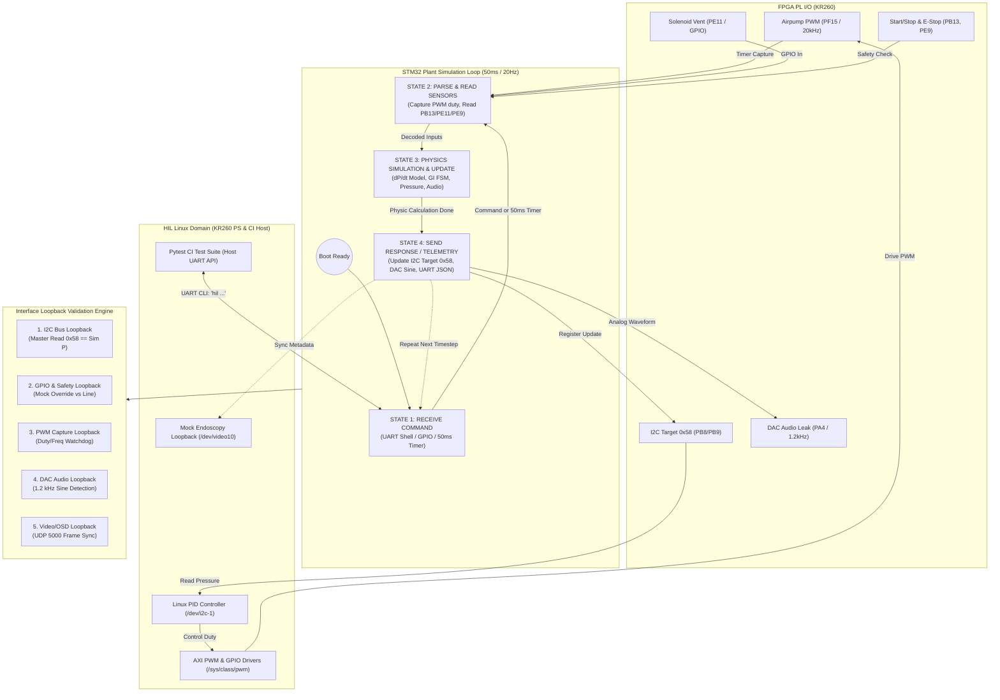
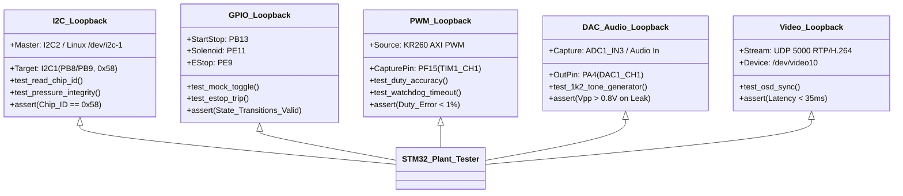

# 05: STM32 Mock Plant State Machine & Interface Architecture

เอกสารนี้อธิบายสถาปัตยกรรมการทำงานของ **STM32H563ZI Plant Simulator Firmware** โดยแบ่งโครงสร้างออกเป็น 4 ขอบเขตหลัก (Domains) อย่างชัดเจน:
1. **FPGA Input and Output (KR260 PL)**: การเชื่อมต่อระดับสัญญาณฮาร์ดแวร์ระหว่าง Kria KR260 PL กับ STM32 Nucleo
2. **STM32 Mock Plant State Machine**: วงรอบการทำงาน 4 ลำดับขั้นหลัก (State 1 → State 2 → State 3 → State 4) และ Finite State Machine ของระบบทางเดินอาหาร (GI Plant Physics)
3. **HIL Linux (KR260 PS & Host CI Controller)**: โปรเซสระดับ Linux OS สำหรับควบคุม Closed-loop PID, รับสตรีมวิดีโอ V4L2, และรัน Pytest CI/CD Harness
4. **Test Loopback in Each Interface**: กลไกการทดสอบ Loopback Self-Test ครบทุกอินเทอร์เฟซเพื่อยืนยันความสมบูรณ์ของระบบก่อนและระหว่างการทดสอบ

---

## 1. ผังรวมสถาปัตยกรรม (System Architecture Diagram)

ดูภาพแผนผังความละเอียดสูงได้ที่:
- **Vector SVG Diagram**: [stm32_plant_state_machine_interfaces.svg](file:///c:/Users/th62034660/Desktop/kria260-stm32-hil-cicd/docs/images/stm32_plant_state_machine_interfaces.svg)
- **High-Res PNG Diagram**: [stm32_plant_state_machine_interfaces.png](file:///c:/Users/th62034660/Desktop/kria260-stm32-hil-cicd/docs/images/stm32_plant_state_machine_interfaces.png)



---

## 2. การแบ่งขอบเขตหน้าที่ (Domain Breakdown)

### Domain A: FPGA Input and Output (KR260 PL)

| สัญญาณ (Signal) | ขาฮาร์ดแวร์ STM32 | ทิศทาง (Direction) | คุณลักษณะสัญญาณ (Signal Spec) | หน้าที่ในระบบ HIL |
| :--- | :--- | :--- | :--- | :--- |
| **Airpump PWM** | `PF15` (TIM1_CH1) | FPGA PL $\rightarrow$ STM32 IN | 20 kHz, Duty 0–100%, 3.3V LVCMOS | คำสั่งความเร็วมอเตอร์ปั๊มลมจากอัลกอริทึม PID |
| **Solenoid Valve** | `PE11` | FPGA PL $\rightarrow$ STM32 IN | Active High GPIO, 3.3V | คำสั่งเปิดวาล์วระบายก๊าซฉุกเฉิน / คลายแรงดัน |
| **Start/Stop IO** | `PB13` | FPGA PL $\rightarrow$ STM32 IN | Active Low (Pull-up) | ปุ่มกดสั่งเริ่มหรือหยุดกระบวนการ Insufflation |
| **Emergency Stop (E-Stop)** | `PE9` | FPGA PL $\rightarrow$ STM32 IN | Active Low Hardware Interlock | ตัดการทำงานของระบบทันทีเมื่อเกิดเหตุฉุกเฉิน |
| **I2C Pressure Target** | `PB8` (SCL), `PB9` (SDA) | STM32 OUT $\rightarrow$ FPGA PL | I2C Slave Addr `0x58`, 100/400 kHz | ส่งค่าแรงดันจำลองในกระเพาะและ Status Flags |
| **Acoustic Leak Audio** | `PA4` (DAC1_CH1) | STM32 OUT $\rightarrow$ FPGA PL | Analog Sine Wave 1.2 kHz, 1.8 $V_{pp}$ | เสียงรั่วของก๊าซส่งเข้าวงจร Audio ADC / Pmod MIC |

---

### Domain B: STM32 Mock Plant FSM Loop

ลูปการคำนวณหลักทำงานที่ **20 Hz ($dt = 50\text{ ms}$)** ภายใน Zephyr RTOS Thread (`plant_sim_thread_entry`):

```
       [ Boot & Peripherals Ready ]
                   │
                   ▼
┌──────────────────────────────────────────────┐
│  STATE 1: RECEIVE COMMAND                    │
│  - ดักรอคำสั่งจาก Host UART Shell             │
│  - ตรวจสอบสถานะการเชื่อมต่อของสายสัญญาณ      │
│  - หน่วงเวลาลูป Periodic 50ms                 │
└──────────────────────┬───────────────────────┘
                       │ Command Received or 50ms Elapsed
                       ▼
┌──────────────────────────────────────────────┐
│  STATE 2: PARSE & READ SENSORS               │
│  - วัดค่า PWM Duty Cycle และ Freq (TIM1 CH1) │
│  - อ่านระดับลอจิก Start/Stop, Solenoid, E-Stop│
│  - ถอดรหัสคำสั่ง Shell CLI / Fault Injection │
└──────────────────────┬───────────────────────┘
                       │ Finished Parsing & Sensor Data Ready
                       ▼
┌──────────────────────────────────────────────┐
│  STATE 3: PHYSICS SIMULATION & UPDATE        │
│  - คำนวณสมการจำลองแรงดันก๊าซ dP/dt          │
│  - อัปเดตสถานะ GI Plant FSM (IDLE..ESTOP)    │
│  - ตรวจสอบ Overpressure Protection (>3.5kPa) │
│  - สั่งเปิด/ปิดสัญญาณเสียงรั่ว AC Audio      │
└──────────────────────┬───────────────────────┘
                       │ Physic Calculation Done
                       ▼
┌──────────────────────────────────────────────┐
│  STATE 4: SEND RESPONSE (COMMAND / TELEMETRY)│
│  - เขียนข้อมูลลง I2C Target Register (0x58)  │
│  - ขับคลื่นเสียงออกพอร์ต DAC1_CH1            │
│  - ส่ง JSON Telemetry ออก UART Shell         │
│  - ซิงค์ GI State Flag ให้ระบบกล้องจำลอง     │
└──────────────────────┬───────────────────────┘
                       │
                       └─────────── Loopback to STATE 1 ◄─────┘
```

#### โมเดลฟิสิกส์จำลองแรงดัน (Pneumatic Differential Equation):
$$\frac{dP}{dt} = k_{pump} \cdot \text{Duty} - k_{leak} \cdot P - k_{valve} \cdot P$$
- $k_{pump} = 0.08\text{ kPa}/(\%\cdot\text{s})$
- $k_{leak} = 0.05\text{ s}^{-1}$ (เมื่อเปิด Fault Leak Injection จะเพิ่มเป็น $0.35\text{ s}^{-1}$)
- $k_{valve} = 0.80\text{ s}^{-1}$ (เมื่อเปิด Solenoid Valve `PE11`)

---

### Domain C: HIL Linux Domain (KR260 PS & Host PC)

1. **KR260 Embedded Linux (Petalinux / Ubuntu)**:
   - **Closed-Loop PID Pressure Controller**: อ่านค่าแรงดันจริงจาก `/dev/i2c-1` (I2C Target `0x58`) ทุก ๆ 20 ms เพื่อคำนวณ Error $e(t) = P_{set} - P_{meas}$
   - **AXI Drivers**: ขับสัญญาณ PWM ไปยังมอเตอร์ปั๊มลมผ่าน `/sys/class/pwm/pwmchip0` และขับวาล์วผ่าน `/dev/gpiochip*`
   - **V4L2 Loopback (`/dev/video10`)**: รับวิดีโอจำลองภาพกระเพาะอาหารจาก Host ผ่านเครือข่าย UDP 5000 พร้อมเรนเดอร์ OSD Pressure Overlay
   - **Acoustic Leak Detection**: รับสัญญาณเสียง $1.2\text{ kHz}$ จากพอร์ต DAC ผ่าน ALSA/PulseAudio เพื่อตรวจจับเสียงลมรั่วด้วย FFT

2. **HIL Controller Host PC (Testbench / CI Harness)**:
   - รัน Pytest Suite: `pytest tests/test_hil_stm32.py -v`
   - สื่อสารผ่าน USB-UART Shell (ST-Link VCP, 115200 bps)
   - ฉีด Faults แบบ Real-time เช่น สั่งให้เกิดรอยรั่ว (`hil inject_leak 1`) หรือกด E-Stop (`hil set_estop 1`)
   - บันทึกผลการทดสอบลงไฟล์ CSV: `reports/test_results.csv`

---

## 3. กลไกการทดสอบ Loopback แต่ละอินเทอร์เฟซ (Interface Loopback Engine)

Firmware รองรับคำสั่ง Shell `hil test_interfaces` เพื่อรัน Self-Test ตรวจสอบความพร้อมของทุกอินเทอร์เฟซพร้อมส่งผลลัพธ์แบบ JSON:

```bash
uart:~$ hil test_interfaces
{
  "test": "interface_loopback",
  "i2c_target_0x58": {"status": "PASS", "chip_id": "0x58", "pressure_kpa": 1.50},
  "gpio_inputs": {"start_stop_pb13": 0, "solenoid_pe11": 0, "estop_pe9": 0},
  "pwm_capture_pf15": {"status": "PASS", "duty_pct": 45.0, "freq_hz": 20000},
  "dac_audio_pa4": {"status": "READY", "waveform": "1.2kHz_sine", "active": false},
  "overall_result": "PASS"
}
```

### รายละเอียดการทดสอบของทั้ง 5 อินเทอร์เฟซ:



1. **I2C Bus Loopback**:
   - STM32 Master (หรือ KR260 `/dev/i2c-1`) ส่ง I2C Transaction ไปยัง Address `0x58`
   - อ่านค่า Register `0x00` (Chip ID) และ `0x02–0x03` (Pressure Raw)
   - ยืนยันว่าค่าที่อ่านได้ตรงกับค่าแรงดันจำลองใน State 3 ปัจจุบัน

2. **GPIO & Safety Loopback**:
   - ตรวจสอบทั้งฮาร์ดแวร์จริง (Physical Pin) และซอฟต์แวร์จำลอง (Mock Register Override)
   - คำสั่ง: `hil set_start_stop 1` $\rightarrow$ ตรวจสอบว่าระบบเปลี่ยนเข้าสู่ `GI_STATE_INSUFFLATE`
   - คำสั่ง: `hil set_estop 1` $\rightarrow$ ตรวจสอบว่าระบบตัดเข้าสู่ `GI_STATE_ESTOP` ภายในเวลา $< 1\text{ ms}$

3. **PWM Capture Loopback**:
   - STM32 Timer Input Capture บันทึก Counter ค่าขอบขาขึ้นและขาลงบนขา `PF15`
   - มีระบบ Watchdog: หากไม่มีพัลส์เข้ามาเกิน $200\text{ ms}$ ระบบจะตั้งค่า Duty = 0% และแจ้งเตือนสถานะ PWM Timeout

4. **DAC Audio Leak Loopback**:
   - เมื่อระบบอยู่ในสถานะรั่ว (`LEAK`), DMA จะเริ่มป้อน Look-up Table คลื่นไซน์ $1.2\text{ kHz}$ ไปที่ `PA4`
   - ตรวจสอบแรงดันแอนะล็อกผ่าน ADC ภายในหรือบอร์ด Pmod Audio เพื่อยืนยันว่ามีเสียงฟู่ของลมรั่วเกิดขึ้นจริง

5. **Video & OSD Loopback**:
   - Host ส่งสตรีมวิดีโอกล้องส่องตรวจทางเดินอาหารผ่าน UDP 5000
   - KR260 นำค่าแรงดันจาก I2C Bus มารวมเป็น OSD Text ลงบนเฟรมภาพแบบ Real-time
   - บันทึกและตรวจวัด Frame Drop และ Latency ระหว่างค่าแรงดันกับภาพวิดีโอให้อยู่ในเกณฑ์ $< 35\text{ ms}$

---

## 4. สรุปตารางคำสั่ง Shell API สำหรับการทดสอบ (HIL Shell Reference)

| คำสั่ง (Command) | พารามิเตอร์ (Params) | ตัวอย่างการใช้งาน | ผลลัพธ์ที่คาดหวัง |
| :--- | :--- | :--- | :--- |
| `hil test_interfaces` | - | `hil test_interfaces` | รายงานผล JSON สรุปการทดสอบ Loopback ทุกอินเทอร์เฟซ |
| `hil test_i2c_loopback`| - | `hil test_i2c_loopback` | อ่านค่า Target 0x58 และแสดงผลแรงดันที่อ่านได้ |
| `hil test_audio_leak` | `<0\|1>` | `hil test_audio_leak 1` | เปิด/ปิดคลื่นเสียง $1.2\text{ kHz}$ ที่ขา PA4 โดยตรง |
| `hil inject_leak` | `<0\|1>` | `hil inject_leak 1` | จำลองรอยรั่วในระบบ (แรงดันตก + เปิดเสียงลมรั่ว) |
| `hil set_start_stop` | `<0\|1>` | `hil set_start_stop 1` | จำลองการกดปุ่ม Start/Stop |
| `hil set_solenoid` | `<0\|1>` | `hil set_solenoid 1` | จำลองการสั่งเปิดวาล์วระบายก๊าซ |
| `hil set_estop` | `<0\|1>` | `hil set_estop 1` | จำลองการกดปุ่มหยุดฉุกเฉิน E-Stop |
| `hil get_status` | - | `hil get_status` | อ่านค่า State, Pressure, Duty, Valve, Leak ในรูปแบบ JSON |
