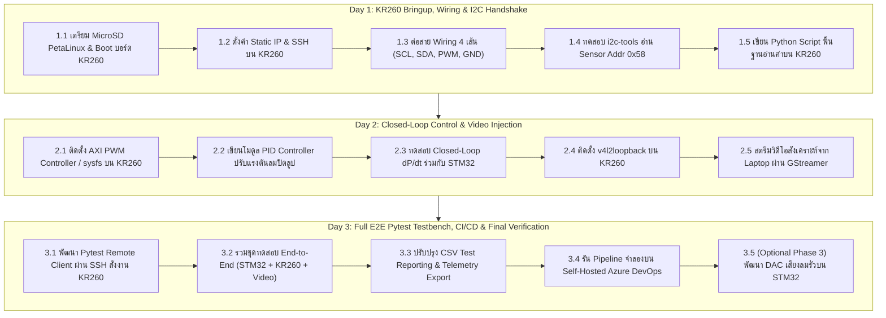

# 3-Day Development & Coding Master Plan (HIL Testbench for Kria KR260 & STM32)

## 📌 ภาพรวมโครงการและเป้าหมายระยะเวลา 3 วัน (Executive Summary)

โครงการนี้มีเป้าหมายเพื่อสร้างระบบทดสอบอัตโนมัติแบบ **Hardware-in-the-Loop (HIL)** สำหรับเครื่องตรวจวินิจฉัยทางการแพทย์ทางเดินอาหาร (GI Detect System) โดยใช้ **AMD Xilinx Kria KR260** ทำหน้าที่เป็นเป้าหมายทดสอบ (Device Under Test - DUT) และ **STM32H563ZI (Zephyr RTOS)** ทำหน้าที่เป็นตัวจำลองระบบกายภาพ (Plant Simulator) พร้อมระบบทดสอบอัตโนมัติผ่าน Host Laptop และรายงานผลแบบ **CSV Format** เข้าสู่ CI/CD Pipeline

---

## 🗓️ ตารางภาพรวมการทำงาน 3 วัน (3-Day Execution Roadmap)

---

## 📂 สารบัญเอกสารแผนงานรายวัน (Document Index)

คลิกที่ลิงก์ด้านล่างเพื่อดูรายละเอียดโค้ดและขั้นตอนการปฏิบัติการแบบเจาะลึก:

1. [Day 1: KR260 Bringup, Hardware Wiring & I2C Handshake](file:///c:/Users/th62034660/Desktop/kria260-stm32-hil-cicd/task_plan/day1_kr260_bringup_and_i2c.md)
   * การเตรียม Boot Media, Static IP, การต่อสาย Jumper ข้ามบอร์ด, และการทำ Handshake ผ่านบัส I2C1
2. [Day 2: Closed-Loop PID Pressure Controller & Video Stream Engine](file:///c:/Users/th62034660/Desktop/kria260-stm32-hil-cicd/task_plan/day2_closed_loop_and_video.md)
   * โค้ด AXI PWM Driver, อัลกอริทึม PID Pressure Controller บน KR260 Linux, และ Virtual Video Loopback Engine
3. [Day 3: End-to-End Pytest Automation, CSV Reporting & CI/CD Pipeline](file:///c:/Users/th62034660/Desktop/kria260-stm32-hil-cicd/task_plan/day3_e2e_hil_and_cicd.md)
   * ชุดทดสอบ Pytest ข้าม 2 บอร์ด, Remote SSH Test Fixtures, CSV Telemetry Generator, และการทดสอบ Pipeline

---

## 🎯 นิยามความสำเร็จเมื่อครบ 3 วัน (Definition of Done)

* [ ] บอร์ด KR260 และ STM32 เชื่อมต่อถึงกันด้วยสายสัญญาณ 4 เส้น และคุยกันผ่าน I2C Addr `0x58` ได้ลื่นไหล
* [ ] อัลกอริทึม Closed-loop สามารถปรับ PWM ไปยัง STM32 เพื่อควบคุมความดันตาม Target Setpoint ได้โดยมีความผิดพลาด $< 5\%$
* [ ] Virtual Camera (`/dev/video10`) บน KR260 รับภาพวิดีโอจาก Host Laptop สำหรับจำลองภาพส่องตรวจกระเพาะอาหาร (GI Stream)
* [ ] รันคำสั่ง `pytest tests/ -v --csv=reports/test_results.csv` บน Laptop แล้วทดสอบทั้ง STM32 และ KR260 ได้อัตโนมัติ โดยสร้างไฟล์รายงานผล CSV ที่สมบูรณ์
* [ ] พร้อมต่อยอดเข้าสู่การรันอัตโนมัติใน Azure DevOps Pipeline
